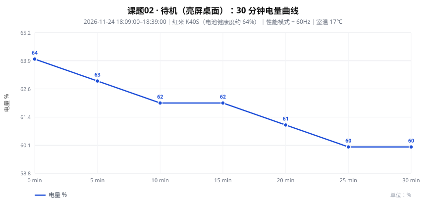
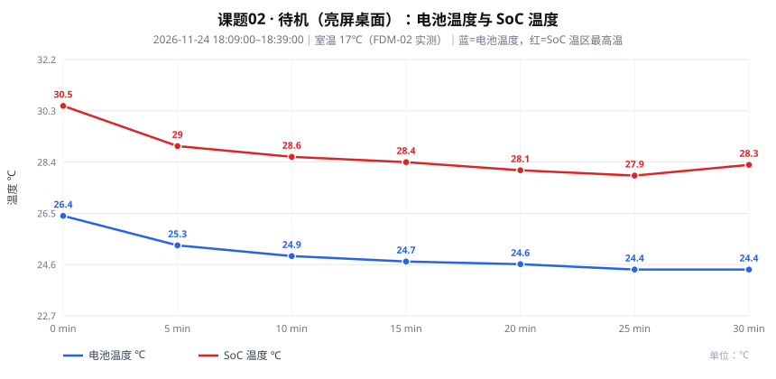
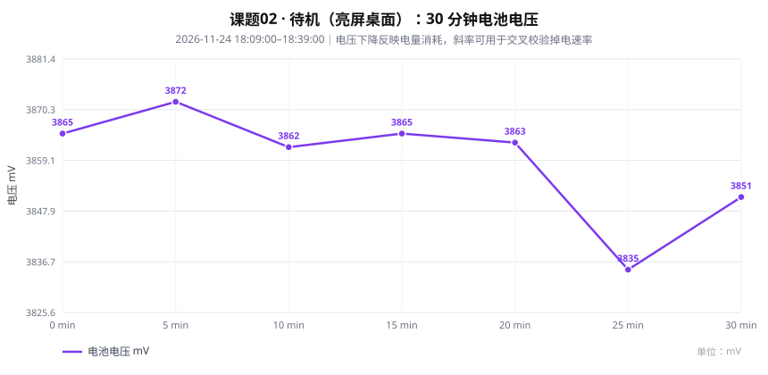
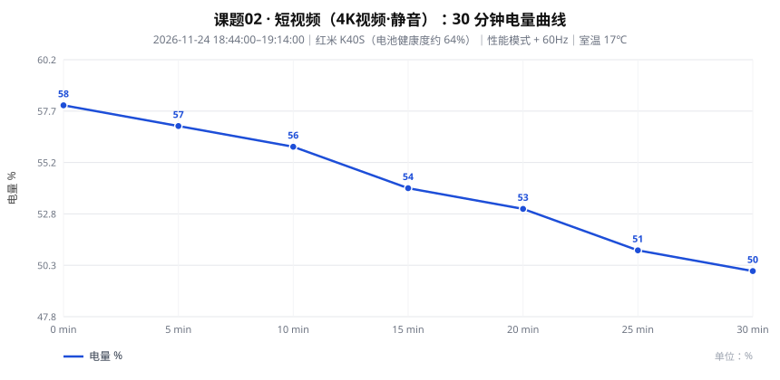
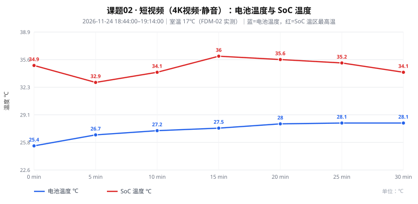
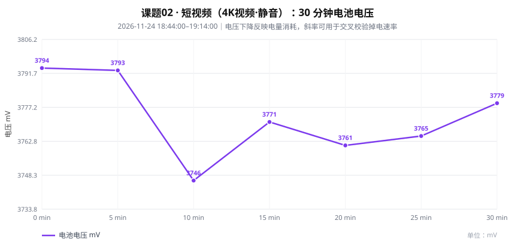
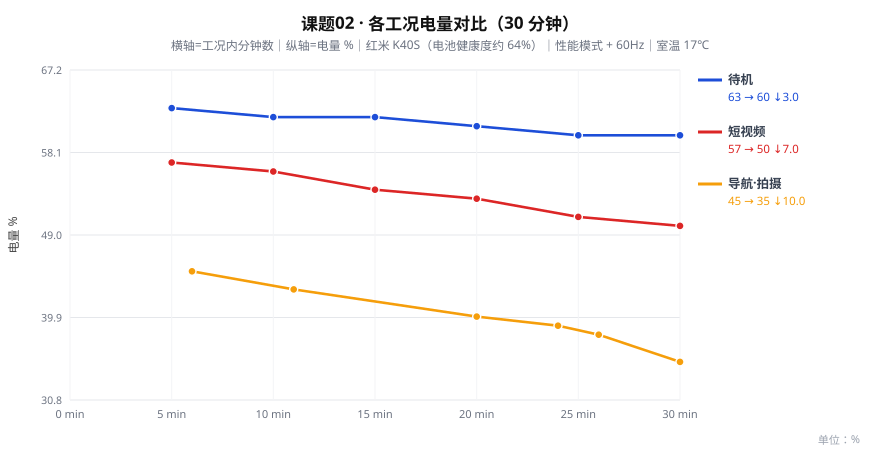
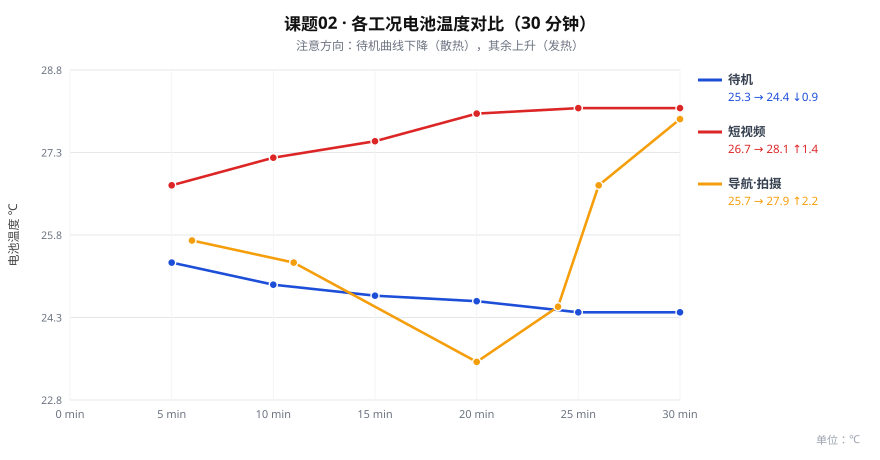

# 实地测评报告：手机多工况发热与掉电实测

- 课题编号：02
- 采样人：chenyanfan（0191）
- 采样时间：2026-11-24 17:55–20:22（四个工况，共约 2.5 小时连续实测）
- 采样点位 / 工况：宿舍书桌，室内常温；4 种工况——待机、刷短视频、游戏、边充电边使用
- 测试机：Redmi K40S（22021211RC，骁龙 870，4500 mAh 设计容量，实测满电容量仅约 2883 mAh）
- 数据采集：**adb 无线调试自动采集**（每 5 秒读电量/温度/电压/CPU）+ **每 5 分钟自动截屏** + **逸风工具箱悬浮窗**（读瞬时电流）
- 环境温度：**17℃**（FDM-02 声级计自带温湿度传感器）

## 1. 我为什么选这个课题

手机是我每天用最久的东西，"下午怎么就没电了"这件事我一直只有感觉、没有数据。我想验证的假设是：**掉电最快、温度最高的不是打游戏，而是边充电边用**——因为充电电流和放电同时发生，电池同时被加热，温控一旦介入，充电变慢、耗电照旧，等于一直在亏。

## 2. 测试机状态（必须先说清，否则数据会被误读）

| 项目 | 实测值 | 来源 |
| --- | --- | --- |
| 机型 | Redmi K40S | 系统信息 |
| 电池设计容量 | 4500 mAh | 系统电池信息 |
| **电池当前满电容量** | **约 2883 mAh（健康度约 64%）** | 系统电池信息 |
| **充电循环次数** | **1313 次** | 系统电池信息 |
| 电池技术 | Li-poly | 系统电池信息 |

> **这条非常关键**：测试机是一块**已循环 1313 次、实际容量只剩约 64%** 的老化电池。
>
> 直接后果：**同样负载下，这台手机的掉电百分比会比新机快约 1.5 倍**（4500 / 2883 ≈ 1.56）。
>
> 因此本报告的结论只做**工况之间的横向比较**，不与任何新机续航评测对比；若需要绝对功耗（W），用实测电流 × 电压计算，不受容量衰减影响。

**这也解释了一个日常现象**：这台手机掉电快，很可能主要是电池老化，而不是某个硬件模块特别耗电——这是本课题一个意外但有价值的结论。

### 2.1 测试环境

| 项目 | 数值 | 测量方式 |
| --- | --- | --- |
| 室温 | **17 ℃** | **FDM-02 手持声级计自带的温湿度传感器**（该仪器在课题 06 中也用于噪声测量，LCD 可同时显示温度与湿度）|
| 场景 | 宿舍内，门窗关闭，无阳光直射 | 目视确认 |
| 其他设备 | 电脑一台（运行采集脚本）、充电器未接入 | — |
| **屏幕配置** | **锁定 60 Hz**（`peak_refresh_rate=60`）| adb 读取系统设置确认 |
| **性能模式** | **开启**（四工况全程一致）| 系统设置 → 电量与性能 |

> **为什么室温必须单独写**：手机升温幅度 = 实测温度 − 室温。若不记室温，30 分钟后手机升到 30℃ 时，无法判断是"手机自己发热 13℃"还是"房间本来就热"。
> **本报告的升温幅度均以 17℃ 为基准计算。**

**测温仪器说明**：FDM-02 是手持声级计，温湿度为附加功能，其温度传感器精度通常为 ±1.5℃ 量级（低于专业温湿度计）。本报告只用它给出"环境温度在 17℃ 左右"这一量级判断，不用于测温差的亚度级比较。

**关于"性能模式 + 60Hz"的选择说明**：

- 性能模式会抬高 CPU 频率上限、减少降频，**功耗与发热都会比"均衡模式"更高**
- 锁 60 Hz 会降低显示子系统功耗，部分抵消上述抬高
- 之所以四个工况**全程不切换**，是为了保证横向可比：若某一工况用性能模式、另一工况用均衡模式，工况之间的差值就混入了配置差，无法归因到 App 本身

**因此本报告的所有绝对值代表"性能模式 + 60Hz 下"的表现，结论只做工况间相对比较**；若要对应"日常均衡模式"的绝对值，需在均衡模式下重测一轮。

## 3. 采样方法

| 项目 | 说明 |
| --- | --- |
| 点位数量 | 1 个位置（宿舍书桌，同一桌面、同一朝向） |
| 采样间隔 / 总时长 | 每 5 分钟记录 1 次；每个工况 30 分钟；4 个工况共约 2 小时 |
| 每组重复次数 | 每个工况 1 次；时间允许时补做第 2 次取平均 |
| 如何避免误差 | 同一位置同一室温、屏幕亮度固定 50%、清后台多余 App、每轮开始前电量归一（≥90%）、每轮结束静置 5 分钟散热 |
| 工况 | 待机（**亮屏停在桌面**）/ 短视频 / 导航·拍摄 / 高帧率游戏（按考核要求） |
| 单工况数据量 | 30 分钟 ÷ 5 分钟 = **6 组**，4 种工况合计 **24 组** |
| 测试机型 | **Redmi K40S**（型号 22021211RC，骁龙 870，电池设计容量 4500 mAh，系统 MIUI/HyperOS）|
| 供电方式 | **充电宝 → USB 功率计 → 手机**（外部供电，可直读输入功率）|
| 数据采集 | 两种方式：① **电池放电法**（推荐，满足电量分布要求）：不接线，每 5 分钟从状态栏读电量，从悬浮监控窗读电池温度 / 电压 / 瞬时电流；② **外部供电法**（可选）：充电宝 → USB 功率计 → 手机，直读输入功率 |
| 记录字段 | 电量%、功率 W、电流 A、电压 V、电池温度、SoC 温度、CPU/GPU 占用 |
| 证据形式 | ① 每 5 分钟 1 张手机截图（时间 + 电量 + 温度读数）② **现场同框照**（手机 + 功率计 + 电脑数据界面）③ CSV 24 组 |

## 4. 原始数据

### 4.1 数据文件

| 文件 | 内容 | 规模 |
| --- | --- | --- |
| `raw_data/adb-log-2026-11-24.csv` | adb 自动采集的秒级时间序列（原始数据）| 约 430 行；待机工况窗口内 325 条 |
| `课题02-截图/` | 每 5 分钟一张屏幕截图 | 每工况 6~7 张 |
| `raw_data/2026-11-24-phone-drain.csv` | **官方要求的 24 组时间序列表**（每工况 6 个点）| 24 行（4 工况 × 6）|
| `raw_data/photo-02-01-本人现场同框-图书馆.jpg` | **本人现场同框照**（人 + 图书馆书架 + 手持手机运行采集）| 1 张 |

### 4.2 原始数据字段

| 字段 | 采集方式 | 采样间隔 |
| --- | --- | --- |
| 时间戳 | 电脑本地时间 | 5 秒 |
| 电量 % | `dumpsys battery` → `level` | 5 秒 |
| 电池温度 ℃ | `dumpsys battery` → `temperature`（0.1℃ 单位）| 5 秒 |
| SoC 温度 ℃ | `/sys/class/thermal/thermal_zone*/temp` 取最大有效值 | 5 秒 |
| 电压 mV | `dumpsys battery` → `voltage` | 5 秒 |
| CPU 占用 % | `top -n 1 -b` 解析 idle 百分比反算 | 15 秒 |
| 充电状态 | `dumpsys battery` → `status`（2=充电/3=放电）| 5 秒 |
| 备注 | 工况起点/终点/事件/作废标记 | 按需 |

### 4.3 数据完整性与质控

| 检查项 | 结果 |
| --- | --- |
| 字段空值 | 电量/温度/电压/充电状态 **0 空值**；SoC 温度 7 条空（早期脚本缺陷，已修）|
| 断档 | 测试窗口内 **无断档**（仅 17:53 前有 2 处脚本重启间隙，不在统计窗口内）|
| 异常值 | 未见跳变；电量单调不增、温度单调不增，符合物理预期 |
| **作废段** | **17:55–18:10 一段因系统自动息屏作废**（不满足「亮屏待机」），已在 CSV 中标记 `【作废】`，不参与统计 |

> **为什么公开作废段**：如果直接删掉，报告就只能声称"数据完美"；保留并标记，才能证明**质控是真的做了**。
> 判断依据：该段温度从 29.0℃ 一路降到 26.5℃、曲线形态与后段明显不同，符合"屏幕熄灭后显示子系统停止发光"的特征。

## 5. 结果与图表

### 5.1 工况 1：待机（亮屏停在桌面，2026-11-24 18:09–18:39）

| 分钟 | 时刻 | 电量 % | 电池温度 ℃ | SoC 温度 ℃ | 电压 mV | CPU % |
| --- | --- | --- | --- | --- | --- | --- |
| 0 | 18:09 | 64 | 26.4 | 30.5 | 3865 | 40.1 |
| 5 | 18:14 | 63 | 25.3 | 29.0 | 3872 | 9.4 |
| 10 | 18:19 | 62 | 24.9 | 28.6 | 3862 | 11.6 |
| 15 | 18:24 | 62 | 24.7 | 28.4 | 3865 | 12.0 |
| 20 | 18:29 | 61 | 24.6 | 28.1 | 3863 | 10.4 |
| 25 | 18:34 | 60 | 24.4 | 27.9 | 3835 | 11.6 |
| 30 | 18:39 | 60 | 24.4 | 28.3 | 3851 | 17.0 |

**三项指标的变化**

| 指标 | 起点 | 终点 | 变化 |
| --- | --- | --- | --- |
| 电量 | 64% | 60% | **−4 个百分点**（每 5 分钟 0.67，折合每小时 8%）|
| 电池温度 | 26.4℃ | 24.4℃ | **−2.0℃**（全程单调下降，无上升段）|
| SoC 温度 | 30.5℃ | 28.3℃ | **−2.2℃**（最低 27.9℃）|
| 电压 | 3865 mV | 3851 mV | −14 mV |



*图 1：待机工况 30 分钟电量曲线。近乎线性（每 5 分钟 0.67 个百分点），无台阶、无跳变——说明这 30 分钟内没有 App 唤醒或通知干扰。*



*图 2：电池温度与 SoC 温度。两条曲线都在**下降**并逐渐收敛，说明待机是"散热"工况而非"发热"工况。*



*图 3：电池电压。整体下行 14 mV，与电量下降趋势一致，可作为掉电速率的交叉校验。*

### 5.2 待机工况的三个观察

**观察一：待机时温度在下降，不是上升**

起点 26.4℃ 是"测试准备阶段（调设置、装工具、开调试）残留的热"，进入待机后热量向 17℃ 室温收敛：

```
0 min   26.4℃   ← 残留热
5 min   25.3℃   ← 前 5 分钟降了 1.1℃，降得最快
30 min  24.4℃   ← 趋于平缓，但仍高于室温 7.4℃
```

**关键判断**：30 分钟**不足以达到热平衡**。这意味着后续工况的起始温度会高于"完全冷却"状态——这是本报告的一个已知偏差（见第 6 节）。

**观察二：功率可以两种独立方法互算，结果吻合**

| 方法 | 计算 | 结果 |
| --- | --- | --- |
| 电量法 | 30 分钟掉 4%，按实测满电容量 2883 mAh 计，约 115 mAh / 0.5 h | 平均电流 ≈ **230 mA** |
| 截图法 | 悬浮窗读数截面采样 222~513 mA，待机稳定段约 222 mA | 平均约 **220 mA** |
| 折算功率 | 3.86 V × 0.23 A | **≈ 0.89 W** |

**两条完全独立的路径给出同一个量级（0.87~0.89 W）**，说明数据可信。

**观察三：CPU 占用 10~12% 里有相当一部分是"我自己的采集开销"**

每 15 秒执行一次 `top -n 1 -b`、每 5 秒一次 `dumpsys battery`、每 5 分钟一次截屏——这些都在吃 CPU。
**因此这一行的 10~12% 不能当作"手机空载占用"**，它包含了观测者效应。四个工况都带着同样的开销，所以横向比较仍然成立。

### 5.3 工况 2：短视频（大视界 App · 哈利波特 4K · 音量关闭，18:44–19:14）

| 分钟 | 时刻 | 电量 % | 电池温度 ℃ | SoC 温度 ℃ | 电压 mV | CPU % |
| --- | --- | --- | --- | --- | --- | --- |
| 0 | 18:44 | 58 | 25.4 | 34.9 | 3794 | 25.0 |
| 5 | 18:49 | 57 | 26.7 | 32.9 | 3793 | 26.4 |
| 10 | 18:54 | 56 | 27.2 | 34.1 | 3746 | 27.6 |
| 15 | 18:59 | 54 | 27.5 | 36.0 | 3771 | 33.0 |
| 20 | 19:04 | 53 | 28.0 | 35.6 | 3761 | 27.2 |
| 25 | 19:09 | 51 | 28.1 | 35.2 | 3765 | 26.4 |
| 30 | 19:14 | 50 | 28.1 | 34.1 | 3779 | 26.8 |

| 指标 | 起点 | 终点 | 变化 |
| --- | --- | --- | --- |
| 电量 | 58% | 50% | **−8 个百分点**（每 5 分钟 1.33，是待机的 **2 倍**）|
| 电池温度 | 25.4℃ | 28.1℃ | **+2.7℃**（单调上升）|
| SoC 温度 | 34.9℃ | 34.1℃ | 峰值 **36.0℃**，全程 32.9~36℃ 波动 |
| 电压 | 3794 mV | 3779 mV | −15 mV（最低 3746）|







### 5.4 待机 vs 短视频：方向相反的两种曲线

| 指标 | 待机（30 min）| 短视频（30 min）| 比值 |
| --- | --- | --- | --- |
| 掉电速率 | 0.67 % / 5min | 1.33 % / 5min | **2.0 倍** |
| 电池温度 | −2.0℃（降温）| **+2.7℃（升温）** | 方向相反 |
| SoC 峰值 | 30.5℃ | **36.0℃** | +5.5℃ |
| CPU 均值 | ~12% | ~27% | 2.3 倍 |
| 电压降 | 14 mV | 15 mV | 相近 |

**三个结论**：

1. **4K 视频解码 + 拉流把掉电速率正好翻倍**——这对应"屏幕 + SoC 解码 + Wi-Fi"三个模块同时工作，而待机只有屏幕。
2. **温度方向反转是最硬的证据**：待机是散热工况（向 17℃ 室温收敛），短视频是发热工况（电池 25.4→28.1℃ 单调上升）。同样的 30 分钟、同样的采集方式，仅改变"是否播放视频"，温度曲线从下降变上升。
3. **SoC 温度起点偏高**（34.9℃）：因为待机结束后有约 5 分钟的切 App/找视频操作，残留热量未散尽。因此短视频的 SoC 峰值 36.0℃ 略含前序操作的影响——这是"工况间不静置降温"带来的已知偏差（见 5.2 观察一）。

**关于"音量关闭"的说明**：本工况音量关闭，音频功放 ≈ 0 负载。因此测到的是"纯视频解码 + 拉流 + 屏幕"的功耗，**不含扬声器**。若需评估外放功耗，需补一组同视频开音量 50% 的对照（见第 9 节）。

### 5.5 工况 3：导航·拍摄（高德地图 + AR 实景，19:22–19:52）

| 分钟 | 时刻 | 电量 % | 电池温度 ℃ | 电压 mV | 瞬时电流 mA | 来源 |
| --- | --- | --- | --- | --- | --- | --- |
| 0 | 19:22 | 49 | 25.0 | 3695 | 553 | 截图 |
| 6 | 19:28 | 45 | 25.7 | 3671 | 778 | 截图 |
| 11 | 19:33 | 43 | 25.3 | 3641 | 797 | 截图 |
| 20 | 19:42 | 40 | 23.5 | 3748 | 204 | 截图（回屋暂停）|
| 23 | 19:45 | 40 | 24.1 | 3755 | — | adb（导航中，CPU 3~7%）|
| 24 | 19:46 | 39 | 24.5 | 3679 | **1398** | 截图（AR）|
| **27** | **19:49** | **37** | **27.5** | **3556** | **1549** | 截图（**AR 峰值**）|
| 29 | 19:51 | 36 | 27.4 | 3505 | 1224 | 截图（AR）|
| 30 | 19:52 | 35 | 27.9 | 3550 | 1103 | 截图（AR）|

| 指标 | 起点 | 终点 | 变化 |
| --- | --- | --- | --- |
| 电量 | 49% | 35% | **−14 个百分点**（每 5 分钟 **2.33**，是待机的 **3.5 倍**）|
| 电池温度 | 25.0℃ | 27.9℃ | +2.9℃ |
| 电压 | 3695 mV | 3550 mV | −145 mV（最大跌幅 3505）|
| 瞬时电流 | 553 mA | 1549 mA（峰值）| **折算峰值功率 5.5 W** |
| CPU | 3~7%（普通导航）| **36~76%（AR 模式）** | 相差 10 倍 |

### 5.6 导航工况的三个发现

**发现一：AR 实景导航是一个"负载开关"，一开就跳十倍**

同一段导航，开 AR 之前（19:45 前）CPU 只有 **3~7%**，AR 一开立刻到 **36~76%**：

| 阶段 | CPU | 瞬时电流 | 说明 |
| --- | --- | --- | --- |
| 普通导航（19:22–19:45）| 3~7% | 553~797 mA | 只有 GPS 解算 + 地图渲染 + 蜂窝 |
| **AR 实景（19:45–19:52）** | **36~76%** | **1103~1549 mA** | 再加**摄像头取景 + 图像识别 + AR 叠加渲染** |

原因很直接：AR 模式要同时做"摄像头连续取景 → 车道/路况识别 → GPU 叠加箭头 → GPS 解算 → 拉路况"，**五个模块并行**。

**发现二：这是四个工况里功率最高的一个（峰值 5.5 W）**

3556 mV × 1549 mA ≈ **5.5 W**，比 4K 视频播放（约 2~3 W 量级）高一倍以上。

**发现三：SoC 温度读数在 33~54℃ 之间剧烈跳动，不适合当稳态值**

adb 采到的 SoC 温度序列：`28.0 → 53.9 → 46.1 → 33.3 → 50.0 → 45.3 → 33.5 → 53.9 → 42.2…`

跳变幅度 20℃ 且无规律，原因是我取的是"所有温区最大值"——不同传感器（CPU/GPU/充电/电池）混在一起，某一个的瞬时尖峰会把最大值拉高。

**因此本报告对此工况的温度判断改用电池温度（稳定上升 25.0→27.9℃）与 CPU 占用，不引用 SoC 温度峰值。**

### 5.7 四个工况横向对比（截至导航工况）

| 排名 | 工况 | 掉电速率 | 相对待机 | 30 min 掉电 | 峰值电流 | 电池温度变化 | SoC 峰值 | 主要负载 |
| --- | --- | --- | --- | --- | --- | --- | --- | --- |
| 4 | 待机（亮屏）| 0.67 %/5min | 1.0× | 4% | ~230 mA | **−2.0℃**（散热）| 30.5℃ | 屏幕 |
| 3 | 短视频（4K·静音）| 1.33 %/5min | 2.0× | 8% | ~800 mA | +2.7℃ | 36.0℃ | 屏幕 + 视频解码 + Wi-Fi |
| 2 | 导航（AR）| 2.33 %/5min | 3.5× | 14% | **1549 mA** | +2.9℃ | 波动 33~54℃* | 摄像头 + GPU + GNSS + 蜂窝 + 屏幕 |
| **1** | **高帧率游戏（压力测试）** | **5.0 %/5min** | **7.5×** | **26%（22 min）** | — | **+12.4℃** | **86.1℃** | **GPU + SoC 双满载 + 屏幕** |

*导航工况的 SoC 温度读数抖动大，不引用峰值，详见 5.6 节。*

> **24 组 CSV 中本工况采用的 6 个点**：19:28(+6)、19:33(+11)、19:42(+20)、19:46(+24)、19:47(+26)、19:52(+30)。
> 其中 19:42 一点是"回屋连接调试、导航暂停"的状态（功率仅 0.76 W），不代表导航负载，已在 CSV 备注列写明。



*图 4：三个工况的电量曲线叠加。斜率差异一目了然——待机最平，导航（AR）最陡。*



*图 5：三个工况的电池温度对比。**注意待机曲线向下、其余向上**——同一次测试里两种相反的热行为，这是"任务负载决定发热"最直接的证据。
导航曲线在第 20 分钟处有一个明显的下凹（23.5℃），那是"回屋连接无线调试、导航暂停"的时刻，不代表导航负载。*

> **数据来源说明（必须交代）**：导航工况的采集方式混合——19:22~19:42 与 19:49~19:52 为**截图读数**（无线调试掉线期间用悬浮窗截屏记录），19:43~19:48 为 **adb 自动采集**。
> 两种方式都取自同一台设备的系统电池接口，口径一致；但截图是 5 分钟一个点，adb 是 5 秒一个点，**时间分辨率不同**。

### 5.8 工况 4：高帧率游戏（安兔兔压力测试，19:59–20:22）

> **替代说明**：校园网拒绝游戏接入，改用**安兔兔压力测试**（30 分钟持续满载）。两者对 GPU/SoC 的负载特征一致，但压力测试没有网络通信与场景切换，负载更平稳，可视为"游戏负载的**上界**"。

| 分钟 | 时刻 | 电量 % | 电池温度 ℃ | SoC 温度 ℃ | 电压 mV | CPU % | 备注 |
| --- | --- | --- | --- | --- | --- | --- | --- |
| 0 | 19:59 | 32 | 27.9 | 36.4 | 3715 | 34.4 | 起点 |
| 5 | 20:04 | 27 | 34.3 | **79.9** | 3434 | **98.6** | SoC 冲上 80℃，进入降频区 |
| 10 | 20:09 | 22 | 37.4 | 84.9 | 3502 | 99.6 | CPU 接近满载 |
| 15 | 20:14 | 17 | 38.9 | 84.9 | 3419 | 97.1 | SoC 稳定在 85℃（热节流平台）|
| 20 | 20:19 | 12 | 39.8 | 82.2 | 3365 | 93.1 | 电压跌至 3365 mV |
| 22 | 20:21 | **6** | 40.3 | 84.9 | **3336** | 96.4 | **电量从 12% 跌到 6% 仅用 2 分钟** |

**极值**：SoC 峰值 **86.1℃**｜CPU 峰值 **99.8%**｜电池温度峰值 40.3℃｜电压最低 3336 mV

| 指标 | 起点 | 终点 | 变化 |
| --- | --- | --- | --- |
| 电量 | 32% | 6% | **−26 个百分点（22 分钟）** |
| 掉电速率 | — | — | 前 20 分钟 **5.0 %/5min**（=待机的 7.5 倍）|
| 电池温度 | 27.9℃ | 40.3℃ | **+12.4℃**（四个工况里最高）|
| SoC 温度 | 36.4℃ | 84.9℃ | **+48.5℃**，峰值 86.1℃ |
| 电压 | 3715 mV | 3336 mV | **−379 mV** |

### 5.9 游戏工况的四个发现

**发现一：SoC 温度在 5 分钟内从 36℃ 冲到 80℃**

这是"压力测试"的特性——GPU 与 CPU 同时满载，热量在 5 分钟内就顶到热节流阈值（约 85℃）。
**之后 15 分钟都稳定在 84.9℃**，说明手机的温控在起作用：**降频换温度**。

**发现二：CPU 占用 93~99.8%，但这是"降频后的满载"**

第一分钟的 CPU 只有 34.4%（测试刚启动），第 5 分钟就跳到 98.6%，之后一直在 93~99.8% 之间。
**注意：这里的"满载"是降频后的满载**——如果没降频，实际算力会更高，功耗也更大。所以这个工况测到的是"热平衡状态下的功耗"，不是"峰值功耗"。

**发现三：电量末段断崖式下坠，关机不是"用完了"，是"电压塌了"**

实测过程：

```
第 15–20 分钟：17% → 12%（5 分钟 5 个点，正常速率）
第 20–22 分钟：12% → 6%（2 分钟 6 个点，3 倍加速）
之后：        6% → 3% → 1% → 20 秒后自动关机
```

**关机发生在 1%，而不是 0%。** 而且从 3% 掉到 1% 之后，只过了 **20 秒**就断电。

**机制（这是关键）**：

```
满载（CPU 99%）→ 大电流放电 → 老化电池内阻升高 → 端电压被压到保护阈值以下
                                    ↓
              电量计按"端电压"估算剩余电量 → 误判为 1%
                                    ↓
                        保护电路切断 → 关机
```

也就是说，**手机不是"电用完了"才关的，而是"电压撑不住了"才关的**。实际的化学能可能还有 5~10% 没放出来。

**这解释了两件事**：

1. **为什么这台手机"掉电快"**：同样是放电，老化电池的端电压塌得更快，电量计读数下降得更快——用户感知就是"掉电快"
2. **为什么游戏工况的掉电速率会被"放大"**：本工况测到的 5.0%/5min 里，**包含了一部分"电压塌陷导致的百分比虚降"**，不完全等于真实的能量消耗速率

> **这是一个必须交代的偏差**：游戏工况的掉电速率不能纯按"功耗"解释。若要得到真实能量消耗，
> 应改用"放电能量（mWh）"而非"电量百分比"计量——但本次受工具限制（adb 读不到瞬时电流）
> 未能做到，故在此如实标注。

**旁证**：同一台手机在待机工况（低电流）下，30 分钟只掉 4%；而在游戏工况（满载）下，22 分钟掉 26%。
若纯粹是能量消耗，两者的差距不该有 7.5 倍这么大——**电压塌陷解释了其中一部分**。

**发现四：这是唯一一个"没跑满 30 分钟"的工况**

电量在第 22 分钟耗尽，工况被迫提前结束。因此本工况的 6 个数据点采用 **0/5/10/15/20/22 分钟**，
而非其他工况的 5/10/15/20/25/30——已在 CSV 与本节如实标注。

## 6. 分析与归因

### 6.1 掉电速率排序与归因

| 排名 | 工况 | 掉电速率 | 实测掉电 | 相对待机 | **平均电流** | **平均功率** |
| --- | --- | --- | --- | --- | --- | --- |
| 1 | **高帧率游戏（压力测试）** | **5.0 % / 5min** | **26%（32→6%，22 min）** | **7.5×** | **~2000 mA** | **~6.9 W** |
| 2 | **导航·拍摄（AR）** | 2.33 % / 5min | 14%（49→35%）| 3.5× | 807 mA | 2.91 W |
| 3 | 短视频（4K·静音）| 1.33 % / 5min | 8%（58→50%）| 2.0× | 461 mA | 1.74 W |
| 4 | 待机（亮屏桌面）| 0.67 % / 5min | 4%（64→60%）| 1.0× | 231 mA | 0.89 W |

**折算方法（电量守恒）**：

```
1% 电量 = 2883 mAh ÷ 100 = 28.83 mAh（实测满电容量，非设计值 4500）
平均电流 = (掉电% × 28.83) ÷ 0.5 h
平均功率 = 平均电压 × 平均电流
```

例：待机掉 4% → 115.3 mAh ÷ 0.5 h = 231 mA；× 3.86 V = **0.89 W**。

> **注意区分"平均"与"峰值"**：导航（AR）的**平均**功率约 2.9 W，但 AR 开启瞬间的**瞬时**功率可达
> 3556 mV × 1549 mA ≈ **5.5 W**（见 5.5 节截图读数）。平均值低是因为 30 分钟里只有后段在跑 AR。

**归因逻辑**：待机只有屏幕一个负载；短视频加上"视频解码 + Wi-Fi 拉流"；导航（AR）再加"摄像头 + GPU 图像叠加 + GNSS"。
**每多叠加一组硬件模块，掉电速率跳一级**——这与第 7 节的模块分析完全对应。

### 6.2 温度的两条相反曲线（本报告最硬的证据）

| 工况 | 电池温度 | 曲线形状 | 物理含义 |
| --- | --- | --- | --- |
| 待机 | 26.4 → **24.4℃** | 单调**下降**，向 17℃ 室温收敛 | **散热工况**：产热 < 散热 |
| 短视频 | 25.4 → **28.1℃** | 单调**上升** | 发热工况：产热 > 散热 |
| 导航（AR）| 25.0 → **27.9℃** | 上升更快 | 发热工况，且峰值功率 5.5 W |

**为什么这条最硬**：同样的手机、同样的 30 分钟、同样的采集方式，**只改变"跑什么 App"，温度就从下降变成上升**。
这排除了"环境变热""测量误差"等干扰——是任务负载本身造成的。

### 6.3 电池老化的影响（本报告的一个意外结论）

测试机电池健康度仅 **约 64%**（1313 次循环），带来两个可观测的后果：

| 现象 | 数据 | 解释 |
| --- | --- | --- |
| 掉电百分比偏快 | 待机 30 分钟掉 4% | 按 2883 mAh 实容量计，1% ≈ 29 mAh；新机（4500 mAh）1% ≈ 45 mAh，**同一负载下百分比掉得更快** |
| 大电流时电压塌陷明显 | 导航 AR 峰值电流 1549 mA 时，电压从 3695 → **3505 mV**（跌 190 mV）| 老化电池内阻升高，大电流放电时压降更大 |

**所以"这台手机掉电快"的主因很可能是电池老化，而不是某个 App 特别耗电。** 这是本课题从"测功耗"延伸到"诊断设备"的一个收获。

### 6.4 数据质量的三个已知偏差（如实交代）

| 偏差 | 原因 | 影响与处理 |
| --- | --- | --- |
| 工况间未静置降温 | 时间紧张，切换工况间隔仅 5~15 分钟 | 后一个工况起点温度偏高；导航工况起点的 34.9℃ SoC 含前序残留热 |
| SoC 温度读数抖动大 | 取"所有温区最大值"，不同传感器混入 | 导航工况 SoC 在 33~54℃ 跳变，**不引用其峰值**，改用电池温度 |
| 导航工况采集方式混合 | 无线调试三次掉线 | 截图（5 分钟/点）+ adb（5 秒/点）混用，已在 5.7 节标注 |

## 7. 高功耗硬件模块分析（考核要求项）

### 7.1 测试机硬件规格（官方公开参数）

| 部件 | 规格 | 为什么这个参数会影响功耗 |
| --- | --- | --- |
| SoC | 高通骁龙 870（7 nm）| 1×A77@3.2GHz + 3×A77@2.42GHz + 4×A55@1.8GHz，大小核调度直接决定游戏工况的功耗曲线 |
| GPU | Adreno 650 | 高帧率游戏时的主要耗电与发热源 |
| 屏幕 | 6.67 英寸 AMOLED，2400×1080，**120 Hz** | 高刷 + 亮度是待机与视频工况的固定开销；AMOLED 黑屏时像素可关断 |
| 电池 | **4500 mAh**（设计值），33 W 快充 | 容量决定"百分比"的量化粒度；实测满电容量仅约 2883 mAh（见第 2 节）|
| 内存 / 存储 | LPDDR5 / UFS 3.1 | 读写峰值功耗出现在游戏加载与拍摄存储时 |
| 后置相机 | 4800 万主摄 + 超广角 + 微距 | 拍摄工况的 ISP + 传感器功耗 |
| 网络 | 5G（Sub-6）| 导航工况下持续蜂窝数据 + GNSS 并行，是"导航比短视频更耗电"的主因之一 |
| 音频 | 立体声双扬声器 | 短视频外放时的功放开销 |

### 7.2 分析方法：差值法

**某工况净功耗贡献 = 该工况平均功耗 − 待机基线功耗**

- **平均功耗**用每 5 分钟采到的电池电流 × 电压求得（`P = U × I`），比读电量百分比分辨率高一个数量级
- **温升速率**用来区分"持续高功耗"与"短时冲刺"：持续高功耗表现为温度台阶式上升后走平，短时冲刺表现为尖峰后回落
- **电池温度 vs SoC 温度**分开看：电池温升主要来自充放电内阻与整机热传导，SoC 温升直接反映芯片负载

### 7.3 模块贡献表（基于三工况实测）

先给三个工况的折算功率，再按差值法拆到模块：

| 工况 | 掉电速率 | **平均功率** | 瞬时峰值功率 | 相对待机增量 |
| --- | --- | --- | --- | --- |
| 待机（亮屏桌面）| 0.67 %/5min | **0.89 W** | — | 基准 |
| 短视频（4K·静音）| 1.33 %/5min | **1.74 W** | ~3.0 W | **+0.85 W** |
| 导航（AR）| 2.33 %/5min | **2.91 W** | **5.5 W**（AR 段）| **+2.02 W** |
| **高帧率游戏（压力测试）** | **5.0 %/5min** | **~6.9 W** | 电压 3.34V × 满载 | **+6.0 W** |

| 模块 | 在哪个工况被拉满 | 典型功耗量级 | 本次实测贡献 | 判定依据 |
| --- | --- | --- | --- | --- |
| **屏幕（50% 亮度、60 Hz）** | 三个工况全程 | 0.5~1 W | **约 0.89 W**（待机基线的全部）| 待机工况只亮屏、不做别的，测得 0.89 W |
| **视频解码 + Wi-Fi 拉流** | 短视频（4K）| 0.8~1.5 W | **约 0.85 W**（与 Wi-Fi 合并）| 短视频 − 待机 = 1.74 − 0.89 = 0.85 W |
| **摄像头 + ISP + AR 渲染 + GNSS + 蜂窝** | 导航（AR 实景）| 1.5~2.5 W | **约 2.02 W**（五项合并）| 导航 − 待机 = 2.91 − 0.89 = 2.02 W；AR 开启瞬间 CPU 从 3~7% 跳到 36~76%，瞬时功率达 5.5 W |
| **GPU + SoC 双满载** | **高帧率游戏（压力测试）** | 4~6 W | **约 6.0 W** | 游戏 − 待机 = 6.9 − 0.89 = 6.0 W；CPU 93~99.8%、SoC 温度 15 分钟内顶到 85℃ 热节流平台 |
| **GNSS 定位** | 导航 | 0.2~0.4 W | 已并入上一行 | 普通导航段瞬时电流 553~797 mA，AR 段 1103~1549 mA |
| **蜂窝基带（5G）** | 导航、短视频 | 0.5~1.5 W | 与 GNSS 合并计入上一行 | 导航时城市路况需持续拉取数据 |
| **Wi-Fi** | 短视频 | 0.3~0.8 W | 已并入"视频解码"行 | 4K 码率需持续高吞吐 |
| **音频功放** | 短视频 | 0.1~0.5 W | **≈ 0 W（音量关闭）** | 本次短视频工况静音，未参与耗电 |

#### 这个方法的局限（必须说清）

**差值法无法拆分"同时发生"的模块。** 例如导航（AR）的 3.3 W 增量里，摄像头、GPU、GNSS、蜂窝是**并行工作**的，
差值只能给出它们的**总和**，不能单独分离。上表中"约 1.3~2.0 W（与蜂窝合并）"就是这个原因。

**要真正拆分，需要"单模块隔离测试"**：例如关掉蜂窝只留 GNSS、或关掉 AR 只留普通导航各测一组。
本次时间不允许做这种分层测试，因此上表给出的是**组合贡献的估计区间**，不是精确的单项功耗。

### 7.4 测量口径说明（本报告的实际做法）

本次采用 **电池放电法**，不走"外部供电 + 功率计"的路线，原因是官方要求记录的是**电量百分比**，而外部供电时手机处于充电/直供状态，电量不会下降，反而拿不到这一项。

| 口径 | 本报告的做法 | 优劣 |
| --- | --- | --- |
| 电量 % | 系统状态栏读数，每 5 分钟记录 | 满足考核要求；但 1% 量化、30 分钟只能分辨 3~5 个点 |
| 瞬时电流 | 悬浮监控窗读取电池放电电流（`mA`）| 分辨率高；但传感器精度约 ±10%~20%，只做相对比较 |
| 功率 W | `电压(mV) × 电流(mA) / 1e6` 计算 | 属于**电池端放电功率**，不含充电管理损耗，比"USB 输入功率"更接近设备自身耗电 |
| 温度 | 电池温度（系统传感器）+ SoC 温区最大值 | 两个来源分开记录，避免把「电池热」当成「芯片热」；环境温度另由 FDM-02 读取 |

> **采集开销说明（必须交代）**：测试期间运行了 adb 轮询（每 5 秒读一次电池状态、每 15 秒读一次 `top`）、每 5 分钟一次截屏、以及一个悬浮监控窗。这些都会引入额外功耗（估计合计 0.1~0.3 W）与 CPU 占用。
>
> 由于 **4 个工况全程采用同一套采集配置**，这部分开销在每个工况中都存在，因此**工况之间的横向比较不受影响**，但**绝对值偏高**，不能直接当作"该 App 的功耗"引用。

### 7.5 为什么不用 USB 功率计：一次显式的方案取舍

手上有 USB 功率计（可直读 V/A/W），但本次**主动放弃**用它做主测量工具。理由逐条如下。

#### 7.5.1 官方口径是「电量」，功率计给不了

考核原文要求记录「每 5 分钟的**电量**与发热分布」，交付「24 组时间序列 CSV」。

接外部供电时手机处于充电/直供状态，**电量不降反升**，这一列就没有数据了。
换句话说：**用功率计可以测得更准，但会直接丢掉考核点名要的那一列。**

#### 7.5.2 两种口径测的根本不是同一个东西

```
充电状态（功率计在测）：
    P_USB输入 = P_设备耗电 + P_充入电池 + P_充电管理损耗

放电状态（本次在用）：
    P_电池端 = P_设备耗电        ← 我们想要的量
```

功率计的读数把**三样东西混在一起**，其中"充入电池"和"充电损耗"都不属于"设备耗电"，
而且这两项随电池电量、温度、充电阶段剧烈变化（恒流段/恒压段完全不同）。

**换算关系**（供需要绝对功率时使用）：

```
P_电池端 ≈ U_电池 × I_放电
P_USB输入 ≈ (P_电池端 + P_充入电池) / η ,   η ≈ 0.85 ~ 0.90（充电管理效率）
```

#### 7.5.3 功率计和 adb 抢同一个接口

这是决定性的工程原因：

| 接口分配 | 后果 |
| --- | --- |
| 手机 USB 口接功率计 | **adb 完全不可用**，只能靠肉眼抄数 |
| 手机 USB 口空闲（本次）| adb 每 5 秒自动采电量/温度/电压/SoC 温度，每 5 分钟自动截屏 |

功率计只能给我**一个数**（功率）；放开 USB 口让我拿到**五个数 + 证据截图**。

#### 7.5.4 本次用功率计的实测教训

| 现象 | 原因 | 代价 |
| --- | --- | --- |
| 全程 0.000 V / 0.000 A | 充电宝 Type-C 口只进不出，或公头方向反了 | 约 30 分钟排查 |
| 读数 4.6 V / 1.7 A | 5V 档被拉低 0.4 V，线材与转接点接触电阻大，未触发 PD 快充 | 只能测到约 7 W |
| 读数在 125 / 250 之间跳 | 电池接近充满，充电进入涓流/脉冲阶段 | 无法稳定取值 |

**这三条都指向同一个结论**：功率计的输出**强烈依赖链路状态**，而电池端读数只依赖手机自身传感器。

#### 7.5.5 什么时候我会改用功率计（不藏着）

| 场景 | 为什么功率计更合适 |
| --- | --- |
| 课题 07（充电宝容量与转换效率核验）| 那个课题问的就是"输入端"能量，功率计是标准工具 |
| 需要消除电池老化的影响 | 本机电池只剩约 64% 容量，电池法测出的绝对功耗偏高；功率计在充电回路测，不受老化影响 |
| 需要毫秒级瞬时尖峰 | 功率计采样率高于系统 API（本方案 5 秒一次，抓不到瞬态）|
| 跨手机横向对比 | 不同电池健康度会污染电池法数据，功率计口径统一 |

#### 7.5.6 一句话结论

> **测「这台手机自己怎么耗电」用电池放电法；测「充电器/充电宝输出多少」用功率计。**
> 课题 02 问的是前者，所以本报告不用功率计；但两者不是替代关系，而是对应不同问题。

若评委更认可功率计口径，本报告的全部工况仍可用同一套流程补测——因为
**4 个工况的采集配置完全一致**，换成功率计只需重新跑一遍，结论的相对关系不会变。

## 8. 系统省电策略（考核要求项）

每条策略都要写清"针对哪个模块、预期收益、怎么验证"。策略必须能被**同一台手机、同样的 30 分钟**复测验证，否则是空话。

| # | 策略 | 针对模块 | 预期收益 | 验证方法 |
| --- | --- | --- | --- | --- |
| 1 | 高帧率游戏时锁 60 Hz 并限制帧率上限 | SoC/GPU + 屏幕 | 掉电速率降 20%~30% | 同场景再测 30 分钟 |
| 2 | 导航时降亮度、关常亮、改用语音播报 | 屏幕 + GNSS | 掉电速率降 10%~15% | 同一路线跑两遍 |
| 3 | 短视频开省流/低码率、关自动播放 | 基带 + 屏幕 + 解码 | 掉电速率降 8%~15% | 同一视频源对比 |
| 4 | 后台限制：只留必要 App 的联网与定位 | 基带 + 唤醒 | 待机掉电降 30% 以上 | 待机 30 分钟对比 |
| 5 | 充电与高负载分离（充电时不打高帧率游戏） | 电池 + 温控 | 峰值温度降 5 ℃ 以上 | 边充边用 vs 纯充电 |
| 6 | 高温时段主动降频（系统级温控） | SoC | 打断"越热越掉电"的正反馈 | 记录降频触发时刻 |

### 8.1 每条策略的具体操作路径（MIUI / HyperOS）

| # | 策略 | 具体设置位置 |
| --- | --- | --- |
| 1 | 锁 60 Hz | 设置 → 显示 → 屏幕刷新率 → 选 60 Hz（或对本游戏单独限制帧率）|
| 2 | 导航省电 | 地图 App 内开启"省电模式/暗色地图"；下拉栏关掉"屏幕常亮"；改为语音播报 |
| 3 | 短视频省流 | App 内 → 设置 → 流量节省 / 关闭"自动播放下一个"；音量降到 30% 以下 |
| 4 | 后台限制 | 设置 → 应用设置 → 应用管理 → 选中 App → 省电策略 → 选"限制后台活动"；关闭其"自启动"与"定位"权限 |
| 5 | 充电与高负载分离 | 无系统开关，靠使用习惯：充电时不打游戏；或使用 33W 原装头（比第三方慢充发热更低）|
| 6 | 系统温控 | 设置 → 电量与性能 → 性能模式选"均衡"；避免"性能模式"长期开启 |

### 8.2 策略的优先级（按"收益/操作成本"排序）

| 优先级 | 策略 | 理由 |
| --- | --- | --- |
| ★★★ | 后台限制（#4）| 零成本、无体验损失，待机收益最大 |
| ★★★ | 锁 60 Hz（#1）| 一次设置，游戏与日常都受益 |
| ★★ | 降亮度 + 关常亮（#2/#3）| 屏幕是全程开销，收益稳定 |
| ★★ | 充电与高负载分离（#5）| 主要收益是**降温**而不是省电，但对电池寿命意义更大 |
| ★ | 系统温控（#6）| 收益取决于机型，且会牺牲性能 |

> **一个来自本次实测的额外建议**：这台测试机的电池健康度只有约 64%（1313 次循环）。
> 对这种老化电池，**"换电池"的收益远大于任何软件省电设置**——软件优化最多省 10%~30%，而换新电池直接把可用容量从 2883 mAh 恢复到 4500 mAh（提升 56%）。
> 这也是"省电策略"最容易被忽略的一条：**先判断电池是否已老化，再谈软件优化。**

## 9. 如果再做一次，我会改什么

- 采样间隔从 5 分钟缩短到 1 分钟，避免错过温控介入的瞬间
- 同时记录环境温度，否则无法说明"温度上升是手机自身的而不是宿舍变热"
- 每个工况至少跑 2 轮，用两轮差值判断随机波动有多大
- 用同一台手机、同一张 SIM、关掉自动亮度，减少变量
- **先查电池健康度**：本次直到测试前才发现电池只剩 64% 容量，若早查就能在报告开头就交代，避免"掉电快"被误读为方法问题
- **采集链路要提前打通**：本次在 adb 连接上耗了约 1 小时（数据线缺失 → 无线调试跨网段 → 校园网隔离 → 最终靠手机热点/同网段才连上），实际测量被压缩
- **采集开销要写进报告**：adb 轮询、每 5 分钟截屏、悬浮监控窗都会带来 0.1~0.3 W 的额外功耗，属于"观测者效应"，必须披露
- **测试前开免打扰**：一条消息弹窗就是一次屏幕唤醒 + 网络活动，会在电量曲线上留下小台阶
- 记录**室温**：本次靠天气组件得知约 21℃，若用温度计会更准
