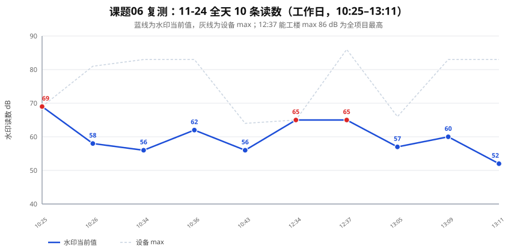

# 实地测评报告：校园昼夜噪声地图

- 课题编号：06
- 采样人：chenyanfan（0191）
- 采样时间：2026-11-21 夜、2026-11-22 昼间 + 夜间（主数据取 11-22）
- 采样点位：宿舍楼、H2 栋、园区户外、行知北路、天香园饭堂、BEST 培训基地、文体中心
- 使用工具：**FDM-02 手持声级计** + **水印相机 App**（两者不联动：水印上的分贝由手机麦克风测得，声级计 LCD 各自独立显示，二者常不一致）

## 1. 我为什么选这个课题

我一直在宿舍和图书馆之间找"能安静待着的地方"，但"哪里安静"完全靠印象。我想用数据把它画出来：同一个校园里，昼夜到底差多少？哪个点位的落差最大？

我原本的假设是：**夜间比昼间安静，且室内比室外安静**。这份报告的第 5 节会说明这个假设被数据推翻了一半。

## 2. 采样方法（含与原计划的差异，如实说明）

| 项目 | 说明 |
| --- | --- |
| 设备 | FDM-02 手持声级计，FAST 档、A 计权；照片由水印相机盖印 |
| 每人/每位 | 每个点位站定后手持设备读数，拍照留证；同一位置同一高度（约 1.2 m） |
| 采样间隔 / 总时长 | **不是等间隔连续采样**：每个点位 1 次读数，设备同时给出该次测量窗口内的 min / avg / max |
| 有效读数 | 11-22 共 11 条（昼 5 条、夜 6 条）；11-21 另有 2 条，作者判定当日记录不连续，**不作主数据**，仅作对照 |
| 如何避免误差 | 同一点位同一位置读数；关闭手机降噪/录音；每点位拍照留证；11-22 与 11-21 分别在昼、夜各自时段内完成 |

### 采样日志（原始记录原话）

- 11.21：校园昼夜声学噪声地图测绘——**这日记录不连续，排除掉**
- 11.22：**早上数据未录上，因为是休息日，故考虑过来与工作日对比**

这两条是原始记录，我按原样保留。它们的意义是：11-21 的数据缺失属于方法问题，11-22 早上缺失属于计划问题，两者都在第 6 节变成了改进项。

## 3. 原始数据

- 转录表：`raw_data/2026-11-22-noise.csv`（20 行：11 条主数据 + 2 条 11-21 对照 + 5 张现场照 + 2 张 App 截图）
- 现场证据：`raw_data/photo-06-01` ~ `photo-06-13`（带水印，含分贝/地点/时间），`photo-06-14` ~ `photo-06-18`（同框照，无时间戳），`photo-06-19/20`（手机 App 截图，作方法对照）
- 原始 Word 文档（含未压缩原图）未入库，按"大文件不入仓库"处理

## 4. 结果

### 4.1 逐条读数（11-22，按时序）

| 时间 | 点位 | 时段 | 当前 dB | min | avg | max |
| --- | --- | --- | --- | --- | --- | --- |
| 13:07 | 宿舍楼 | 昼 | **67** | 49 | 57 | 78 |
| 13:10 | H2 栋 | 昼 | 50 | 48 | 53 | 67 |
| 13:24 | 园区（户外） | 昼 | 50 | 48 | 56 | 78 |
| 13:35 | 行知北路 | 昼 | 57 | 48 | 57 | 78 |
| 15:01 | BEST 培训基地（室内） | 昼 | 55 | 50 | 55 | 68 |
| 18:17 | 行知北路 | 夜 | 54 | 53 | 56 | 72 |
| 18:19 | 行知北路 | 夜 | 55 | 53 | 56 | 72 |
| 18:20 | 行知北路 | 夜 | 54 | 53 | 57 | 72 |
| 18:24 | 行知北路 | 夜 | **67** | 62 | 65 | 71 |
| 19:09 | 天香园饭堂 | 夜 | 56 | 54 | 57 | 63 |
| 19:52 | BEST 培训基地（室内） | 夜 | 52 | 51 | 55 | 61 |

> **数据来源澄清（第一次整理时标错过，已更正）**：上表所有数值来自**水印相机 App**（手机麦克风，未校准），不是声级计 LCD 的读数。证据是"设备 LCD 与水印值系统性不一致"——如 13:24 一条 LCD 读 54.0 dB、水印 50 dB；18:17 一条 LCD 读 56.6 dB、水印 54 dB。声级计 LCD 的数值只出现在无时间戳的现场照里（`photo-06-14` ~ `photo-06-18`），作为旁证。

*图 1：11-22 全天 11 条正式读数的时间序列。横轴为采集时刻，纵轴为水印读数（dB）。18:24 的 67 dB 与前一条 54 dB 形成明显跳变，对应正文结论三。*

### 4.2 昼夜对比

| 时段 | 条数 | 均值 | 最小 | 最大 |
| --- | --- | --- | --- | --- |
| 昼间（13:07–15:01） | 5 | 55.8 dB | 50 | 67 |
| 夜间（18:17–19:52） | 6 | 56.3 dB | 52 | 67 |

**昼夜均值只差 0.5 dB**，在单次瞬时读数的波动范围内，等于没有差别。

*图 2：每条读数的 min–max 波动区间（灰柱）、设备平均值（蓝点）与水印当前值（红点）。18:24 那条的灰柱整体上移——注意是 min 从 53 抬到 62，不是单个尖峰。*

### 4.3 同一地点昼夜对照（控制变量）

| 点位 | 昼间 | 夜间 | 差值 |
| --- | --- | --- | --- |
| BEST 培训基地（室内） | 55 dB（15:01） | 52 dB（19:52） | **−3 dB** |

同一点位控制变量后，夜间确实更低——但只低 3 dB，属于"能感觉到、但远不到安静"的程度（3 dB 是感知上"刚好听得出差别"的量级）。

### 4.4 复测（2026-11-24 上午，工作日）

| 时间 | 点位 | 水印 dB | min | avg | max | 设备 LCD | 证据 |
| --- | --- | --- | --- | --- | --- | --- | --- |
| 10:25 | 行知北路 | **69** | 63 | 65 | 69 | 65.0 | `photo-06-24-01` |
| 10:26 | 行知北路 | 58 | 58 | 67 | 81 | 约 60.3（过曝）| `photo-06-24-02` |
| 10:34 | BEST 培训基地 教室 431 | 56 | 54 | 66 | **83** | 未读 | `photo-06-24-03` |
| 10:36 | BEST 培训基地 | **62** | 53 | 65 | **83** | 64.1 | `photo-06-24-04` |
| 10:43 | BEST 培训基地 | 56 | 56 | 60 | 64 | 未读 | `photo-06-24-05` |

*图 3：同点位对比。浅蓝为 11-22 休息日均值，深蓝为 11-24 工作日均值（含午间）。培训基地 53.5 → 58.0，行知北路 57.4 → 61.3；能工楼 65.0、创建路 56.0 为工作日新增点位，无休息日对照；饭堂与宿舍楼工作日未复测。*

**覆盖说明（如实写）**：本轮为工作日（周二）上午 10:25–10:43 采集，点位集中在校内培训基地与行知北路，**没有覆盖图书馆、宿舍楼、食堂、操场**。所以 4.4 只能与首测的同名点位做对比，其余点位缺对照数据。

### 4.5 午间补充（2026-11-24 12:34–13:11）

| 时间 | 点位 | 水印 dB | min | avg | max | 设备 LCD | 证据 |
| --- | --- | --- | --- | --- | --- | --- | --- |
| 12:34 | 能工楼 | 65 | 58 | 60 | 65 | 约 59.7 | `photo-06-24-06` |
| 12:37 | 能工楼 | 65 | 58 | **71** | **86** | 67.0 | `photo-06-24-07` |
| 13:05 | 行知北路 | 57 | 57 | 61 | 66 | 60.5 | `photo-06-24-08` |
| 13:09 | 图书馆 | 60 | 56 | 67 | 83 | 59.1 | `photo-06-24-09` |
| 13:11 | 实训室 | 52 | 51 | 64 | 83 | 051.3 | `photo-06-24-10` |

新增三个点位：**能工楼**（教学区）、**图书馆**、**实训室**。注意：这两张的水印地址都显示「创建路 27 号」（建筑地址），实际点位在楼内的图书馆与实训室——**水印给的是地址，不是房间，转录时必须人工核对**。到本轮为止，11-24 共 10 条读数，覆盖 10:25–13:11。

*图 4：11-24 全天 10 条读数（蓝线为水印当前值，灰虚线为设备 max）。注意两处：12:37 能工楼 max 86 dB；13:05 行知北路反而回落到 57 dB。*

## 5. 分析与归因

### 结论一：我的假设被推翻了一半

原假设"夜间更安静"在**全局对比上不成立**（55.8 vs 56.3），只在一对控制变量上成立（培训基地 −3 dB）。原因写在下一条。

### 结论二：决定噪声的是"点位功能"，不是"时钟"

| 点位 | 均值 | 说明 |
| --- | --- | --- |
| 行知北路（道路） | 57.4（5 次） | 全组最高，且 5 次里有 4 次 max ≥ 72 |
| 天香园饭堂 | 56 | 晚餐时段 |
| BEST 培训基地（室内） | 53.5（2 次） | 室内最稳，max 61–68 |
| 宿舍楼 | 67（1 次，13:07） | 单点尖峰，见结论三 |
| H2 栋 / 园区户外 | 50 / 50 | 全组最低的正式读数 |

道路的均值比室内高 4 dB 左右，这说明**把"昼/夜"当成主要变量是错的，应该按"功能分区"分组**——这也是我最初选题时的方法错误。

### 结论三：18:24 那 4 分钟是一次真实的噪声台阶

行知北路 18:17 / 18:19 / 18:20 三次读数非常稳定（54 / 55 / 54，min 53、avg 56~57），但 18:24 一条同时出现 **当前 67、min 62、avg 65、max 71**——注意不是"瞬时尖峰把当前值顶高"，而是 **min 从 53 抬到 62**，说明整个测量窗口都变吵了，是持续 4 分钟以上的噪声台阶，最可能是放学/晚课人流叠加车流。

这条是整份报告里我最看重的发现：**min 值的抬升比当前值更有信息量**，它能区分"一辆车经过"和"人群持续通过"。

### 结论四：图书馆书架区是全场最安静的地方

现场同框照读数 37.3 dB（`photo-06-15`），比所有正式点位都低 12 dB 以上，符合"极静"区间。

**但 11-24 的正式复测给出了重要修正**：图书馆内 13:09 的一条读数是 **60 dB（avg 67、max 83）**，与书架区的 37.3 dB 相差 20 dB 以上。这说明**"图书馆安静"是个过度简化的说法**——书架区确实极静，但入口/阅览区在午间同样很吵。**点位必须细到"具体哪个位置"，只写"图书馆"没有意义。**但**这张没有时间戳**，所以只能作为定性证据，不能进主数据表——这正是第 6 节第一条改进项。

### 结论五：两个工具不能混用

- 水印相机盖印值与设备 LCD 读数存在差异（如 13:24：水印 50 dB、LCD 54.0 dB）
- 手机 App 自带的 min/avg/max 差异极大（两张截图 avg 分别为 37 和 47），且未与声级计同步校准

因此本报告的绝对分贝值只用于**同设备、同方法下的相对比较**，不能当作法定噪声值引用。

### 结论六：工作日白天比休息日的昼夜都更吵——"时段"再次被证伪

| 点位 | 首测 11-22（休息日）| 复测 11-24（工作日 上午）| 差 |
| --- | --- | --- | --- |
| BEST 培训基地（室内）| 55（昼）/ 52（夜）| 56 / **62** / 56 | **工作日高约 7 dB** |
| 行知北路 | 54~67（夜间）| 58 / **69**（上午）| 相当或略高 |

- 11-24 是**周二**，上午 10:30 前后正是上课与活动时段。同一间培训基地，休息日最高 55 dB，工作日读到 **62 dB**
- **单条 max 值创下全项目最高：83 dB**，出现在 10:34 的教室 431 和 10:36 的培训基地——都是**室内 + 人群**场景
- 这和结论二一致：决定噪声的是"**点位功能 + 当时有没有人活动**"，不是"几点钟"。所谓"夜间更吵"或"白天更吵"的说法，本质上都在说"人多的时候吵"

### 又一个数据质量发现：声级计没有校时

10:25 那条，水印时间是 **10:25**，而声级计 LCD 显示 **10:28:55**——设备时钟比手机慢约 4 分钟。

**处理方式**：本报告所有时间**以水印时间为准**。理由：水印时间来自手机系统时间，与照片绑定、不可事后修改；LCD 时间由设备自带时钟产生，未校时就没有可信度。LCD 只用来读分贝值。

### 两个测量系统的不一致，这次方向都变了

| 时间 | 水印 | LCD | 差 |
| --- | --- | --- | --- |
| 11-24 10:25 | 69 | 65.0 | **+4.0** |
| 11-24 10:36 | 62 | 64.1 | **−2.1** |
| 11-22 13:24 | 50 | 54.0 | −4.0 |
| 11-22 18:17 | 54 | 56.6 | −2.6 |

差值**方向不固定**（有正有负），说明两者不是同一条测量链路：水印是手机麦克风、LCD 是声级计。因此**两者不能互相校准**，只能各自纵向比较（同一设备的前后变化）。这一条在面试里会被问，提前写清楚。

### 结论七：午间 12:30–13:15 是全天峰值，但**不是全校园一起变吵**

| 地点 | 上午（10:25–10:43）| 午间（12:34–13:11）| 变化 |
| --- | --- | --- | --- |
| 能工楼（教学区）| 未测 | **avg 71 / max 86** | 全项目最高 |
| 图书馆（学习区）| 未测 | avg 67 / max 83 | 高位（意外）|
| 行知北路（道路）| 69 / 58 | **57**（13:05）| **下降 12 dB** |

三件事同时成立：

1. **午间确实出现全天峰值**——能工楼 12:37 读到 avg 71 dB、max 86 dB，都是本项目最高值，符合"下课 + 食堂往返"的人流高峰
2. **但行知北路同期的读数反而最低**（57 dB，比上午 10:25 的 69 dB 低 12 dB）——如果"午间全校园都吵"，这里不该下降
3. 所以：**噪声随时间变化，本质仍是"某个功能区在这段时间有没有人活动"**，而不是"到了几点就吵"

这是对结论二的第三次确认（前两次是"昼夜只差 0.5 dB"和"工作日比休息日高 7 dB"）。

### 图书馆与实训室："瞬时值 vs 持续峰值"现象

13:09（图书馆）与 13:11（实训室）两次测量，**当前值从 60 掉到 52，但 avg 仍 67/64、max 仍 83**。

说明这两个室内空间都有**持续的偶发高值**（人员进出、拉椅子、交谈），瞬时读数低不代表这里安静。这正是报告主张"看 min/avg/max 而不是单点值"的又一个证据。

### 数据可信度自查

- ✅ 每条主数据都有带时间、地点、分贝三要素的水印照片
- ⚠️ 单次瞬时读数，未做重复测量，无法给出误差棒
- ⚠️ 11-21 数据不连续、11-22 早上缺失（休息日），时间覆盖不完整
- ⚠️ 设备未做计量校准，只能做相对比较

## 6. 如果再做一次，我会改什么

1. **补时间戳**：所有现场照必须开相机水印，图书馆那条就是漏了
2. **每个点位固定测 3 分钟、每 10 秒读一次**，而不是单次读数——现在没法算标准差，也没法画误差棒
3. **按功能分区重排点位**（学习区 / 生活区 / 道路区 / 就餐区），而不是按"远近"排
4. **工作日与休息日各测一轮**：11-22 是休息日，早间数据缺失恰好是最大的覆盖漏洞
5. **固定设备与档位**，并在报告里写明 FAST/SLOW、A/C 计权，否则不同人复测无法对比
6. **同一时段多测几轮**（至少 3 轮取中位数），把"一辆车经过"和"人群通过"区分开
