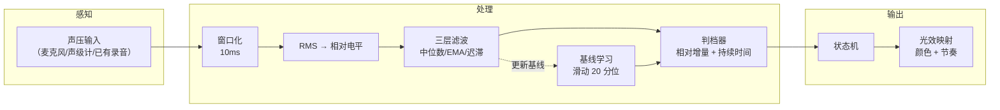
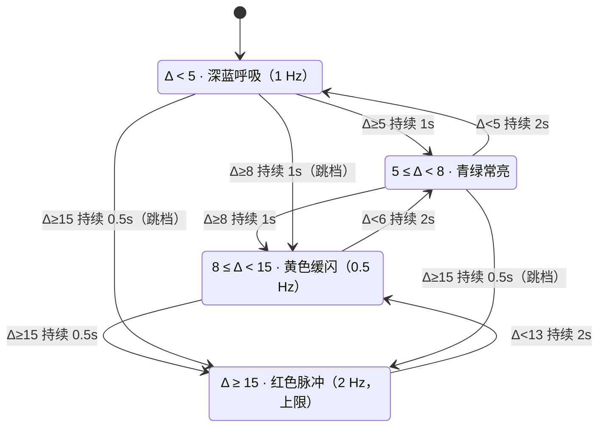
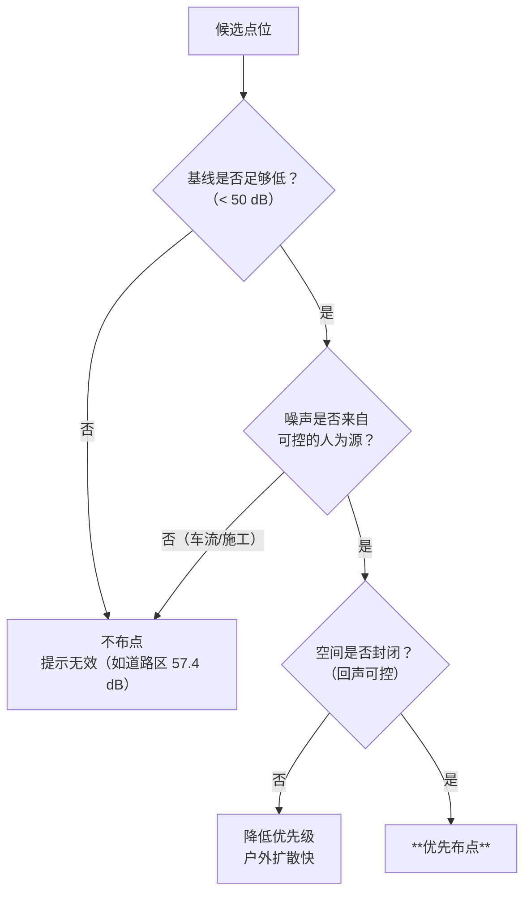

# 校园声学地图与智能光效提醒系统 · 逻辑设计

> **交付边界（重要）**：本方案是**纯逻辑设计**，不包含实物搭建、采购与制造。交付物为：系统逻辑架构、判档与状态机规则、参数依据、边界与异常处理、以及可用纸面/离线程序验证的测试用例。
> 所有需要硬件才能确认的参数，都标注为「待实测标定」，并给出不依赖硬件的替代验证方式。
>
> 方案设计：chenyanfan（0191）｜2026-11-24

## 一、问题定义：什么叫"吵"

这一步不定清楚，后面所有逻辑都是空的。三个必须区分的概念：

| 概念 | 定义 | 为什么不能用别的代替 |
| --- | --- | --- |
| **绝对声压级** | 当前环境的分贝值 | 只用它判档会失败：图书馆 45 dB 已经算吵，马路 55 dB 却很正常 |
| **相对基线** | 当前值 − 该点位"平时"的中位数 | 这才是可移植的判据；不同点位的绝对阈值没有可比性 |
| **持续时间** | 超阈值的连续时长 | 关键防抖量：一声咳嗽 200 ms 和持续喧哗 5 s 必须区别对待 |

**本方案的核心判定逻辑**：不是"超过 X 分贝就报警"，而是"**超出本点位基线 Y 分贝、且持续 Z 秒，才升级状态**"。

这个选择直接来自课题 06 的实测结论：昼夜均值只差 0.5 dB（55.8 vs 56.3），说明**时间不是主要变量、点位功能才是**——既然如此，判档就必须以"点位自身的基线"为参照。

## 二、系统逻辑架构



三层职责边界（这条边界必须清楚，否则逻辑会互相污染）：

- **感知层只负责"把声音变成数字"**，不做任何判断
- **处理层只负责"把数字变成状态"**，不知道灯是什么颜色
- **执行层只负责"把状态变成光"**，不参与判断

## 三、数据链路：每一步的输入、输出、失效模式

| 环节 | 输入 | 输出 | 失效模式 | 处理逻辑 |
| --- | --- | --- | --- | --- |
| 窗口化 | 采样流 | 10 ms 窗口（80 点 @8 kHz） | 采样丢点 | 窗口不足则丢弃该窗，不插值 |
| RMS | 80 点 | 一个电平值 | 直流偏置未去 → 读数恒定 | 先减偏置再平方 |
| 转 dB | RMS | 相对 dB | 除以 0 或极静时 → −∞ | 设下限 −20 dB 截断 |
| 三层滤波 | 单点 dB | 平滑 dB | 连续脉冲被平均掉 | 中位数抗脉冲，EMA 抗毛刺 |
| 基线学习 | 历史 dB | 该点位基线 | 突发长噪声污染基线 | 只取低分位（如 20 分位）作基线 |
| 判档 | 平滑 dB + 基线 | 档位 | 边界振荡 | 迟滞 + 最短驻留 |
| 状态机 | 档位 | 状态 | 状态抖动 | 升级快、回落慢 |

### 为什么基线要用"低分位"而不是"平均值"

平均值会被偶发噪声拉高：一个点位平时 40 dB，若下午吵了 2 小时（70 dB），平均值会被拉到 50 以上，之后装置就"变聋了"。**取 20 分位**（即 80% 的时间都比它吵）能稳定代表"这个点位安静时的底面"。

## 四、判档逻辑：四要素

判档不是单条件，是四个量的组合：

```
当 (平滑dB − 基线) > 增量阈值  且  持续 ≥ 驻留时间  且  通过迟滞判定  时，才升级
```

| 要素 | 取值 | 依据 | 可调性 |
| --- | --- | --- | --- |
| 增量阈值（正常→偏吵） | **+8 dB** | 8 dB 约为"音量翻倍"的心理声学量级，人耳明显可感 | 按点位调 |
| 增量阈值（偏吵→吵闹） | **+15 dB** | 15 dB 约为"必须提高嗓门才能对话" | 按点位调 |
| 驻留时间（升级） | **1.0 s** | 短于 1 s 的多为偶发（咳嗽、关门） | 固定 |
| 驻留时间（回落） | **2.0 s** | 回落必须比升级慢，否则灯会抖 | 固定 |
| 迟滞带宽 | **±2 dB** | 覆盖读数噪声（本底抖动约 1~2 dB） | 固定 |

### 判档决策表（可直接查表实现）

| 相对增量 Δ | 持续时长 | 当前状态 | 下一状态 |
| --- | --- | --- | --- |
| Δ < 5 | 任意 | 任意 | 保持 |
| 5 ≤ Δ < 8 | ≥ 1 s | 静音 | 正常 |
| 8 ≤ Δ < 15 | ≥ 1 s | 正常 | 偏吵 |
| Δ ≥ 15 | ≥ 0.5 s | 偏吵 | 吵闹 |
| Δ < 6 | ≥ 2 s | 偏吵 | 正常 |
| Δ < 13 | ≥ 2 s | 吵闹 | 偏吵 |
| Δ < 5 | ≥ 2 s | 正常 | 静音 |

> **升级可跳档、回落逐级**：档位计时各自独立累计，一旦某档满足驻留时间，直接跳到**满足条件的最高档**（如 Δ=9 持续 1 s，直接进「偏吵」，不在「正常」白等一秒）；回落则每次只降一档。这个规则是写验证脚本时才暴露的——原来的"逐级升级"会让 9 dB 的场景多等 1 秒才变色。

## 五、状态机



**状态设计的三个原则**：

1. **升级快、回落慢**（1 s vs 2 s）：符合人的感知——噪音来了要立刻提示，安静下来不必急着撤销
2. **节奏有上限**（≤2 Hz）：超过 2 Hz 的闪烁会引起不适，且失去"提示"的意义
3. **不用纯红常亮**：避免"报警器"压迫感，红只用于最高档且用脉冲

## 六、三层滤波逻辑

| 层 | 算法 | 参数 | 解决的失效 |
| --- | --- | --- | --- |
| 1 | 5 点中位数 | 窗口 50 ms | 单次冲击（关门、掉落、咳嗽） |
| 2 | 一阶低通 EMA | α = 0.2（时间常数约 250 ms） | 读数毛刺、ADC 抖动 |
| 3 | 迟滞 + 驻留 | ±2 dB / 1 s 与 2 s | 阈值附近的临界振荡 |
| 4 | **状态提交去抖** | 目标状态需稳定 100 ms 才切换 | 阈值穿越时刻差导致 60 ms 的过渡态（绿光闪一下）|

**递进关系**：中位数处理"孤立的坏点"，EMA 处理"连续的抖动"，迟滞处理"判定环节的抖动"。三者作用在数据链路的不同位置，不能合并成一个。

> α=0.2 的推导：一阶低通时间常数 τ ≈ −ΔT/ln(1−α)。ΔT=10 ms、α=0.2 时 τ ≈ 45 ms，即约 45 ms 达 63% 响应、200~250 ms 基本稳定。这与"人对声音变化的反应时间（约 200 ms）"匹配——比人快太多会显得神经过敏，太慢会显得迟钝。

## 七、边界与异常逻辑（最容易被忽略，也最显功力）

| 场景 | 逻辑处理 | 理由 |
| --- | --- | --- |
| **开机** | 前 10 s 不判档，只采集并初始化基线 | 否则一上电就红，像坏了 |
| **传感器失效** | 读数**贴底或贴顶**持续 5 s → 判失效，进入"安全态"（白灯慢呼吸）并记异常 | 防止线路短路/断路还假装正常。**注意：不能用"方差≈0"当判据**——极静环境方差同样≈0，会误判（写脚本时发现的）|
| **静音溢出** | 读数低于下限 → 截断为下限值，不参与中位数 | 防止 −∞ 污染滤波 |
| **持续噪声污染基线** | 基线只取 20 分位，且用 30 分钟滑动窗 | 避免"吵了一下午后装置变聋" |
| **掉电恢复** | 从持久化存储恢复基线，不重新学习 | 否则每次重启都要重新适应 |
| **双阈值冲突** | 按"最高满足档"执行，不允许越级回退 | 防止 Δ 在 15 附近时红黄乱跳 |
| **人声 vs 非人声** | **本版不区分**（明确写进局限） | 区分需要频域分析，超出本方案范围 |

## 八、布点决策逻辑（用课题 06 实测数据推导）

不是"每个地方都放一台"，而是一个决策流程：



套用实测数据的结果：

| 点位 | 基线 | 噪声源 | 结论 |
| --- | --- | --- | --- |
| 图书馆书架区 | 37.3 dB | 人声 | ✅ 首选（基线最低） |
| 宿舍楼（午休） | 67 dB 尖峰 | 人声 | ✅ 次选（尖峰明显，提示有意义） |
| 教学楼走廊 | 50 dB | 人声/脚步 | ✅ 可选 |
| BEST 培训基地 | 55 / 52 dB | 人声 | ⭕ 一般（本身不吵，改善空间小） |
| 行知北路 | 57.4 dB（max 72） | 车流 | ❌ 不布点（提示对车无效） |

## 九、逻辑验证（不需要实物也能做）

这是"只做逻辑"的关键优势——所有规则都能用**纸面用例 + 离线程序**验证：

### 9.1 极端用例表（评审可以直接按表跑）

| # | 输入序列（相对增量 Δ，单位 dB） | 期望输出状态序列 | 验证的规则 |
| --- | --- | --- | --- |
| 1 | 0,0,+20,0,0（单点冲击） | 静音（始终不变） | 中位数吃掉单点冲击 |
| 2 | 0 → +9 保持 2s | 静音 → 偏吵 | 基本升级 |
| 3 | 0 → +9 保持 0.5s → 0 | 静音（不升级） | 驻留时间生效 |
| 4 | +9 与 +7 交替 20 次 | 停在偏吵，不抖 | 迟滞 + 回落慢 |
| 5 | 每分钟 +1，升到 +20 | 静音→正常→偏吵→吵闹 | 逐级升级正确 |
| 6 | +20 持续 10 分钟后骤降 0 | 吵闹 → 偏吵 → 正常（各 2s） | 逐级回落 |
| 7 | 全程恒定 −30 | 静音（不溢出为异常） | 下限截断 |
| 8 | 读数方差为 0 持续 5s | 进入安全态（白灯） | 传感器失效检测 |
| 9 | 开机即 +25 | 前 10 s 静音，之后升吵闹 | 开机静默期 |

### 9.2 实际验证结果（已跑，9/9 通过）

验证脚本：`logic_check.py`（与本方案同目录）。按 10 ms 步长回放输入序列，实现第四~七节全部规则，跑 9 条用例：

| # | 用例 | 结果 | 实测时刻 |
| --- | --- | --- | --- |
| 1 | 单点冲击不误报 | ✅ | 全程静音 |
| 2 | 持续 9 dB 直达偏吵 | ✅ | 11.21 s 进偏吵 |
| 3 | 只持续 0.5 s 不升级 | ✅ | 全程静音 |
| 4 | 边界 9/7 抖动不闪烁 | ✅ | 11.21 s 进偏吵，之后无跳变 |
| 5 | 逐级升到吵闹 | ✅ | 11.20 / 13.14 / 14.64 s |
| 6 | 突变直达吵闹、回落逐级 | ✅ | 10.68 / 12.79 / 18.12 / 20.23 s |
| 7 | 极静不误判为失效 | ✅ | 全程静音 |
| 8 | ADC 贴底 → 安全态 | ✅ | 15.0 s 进安全态 |
| 9 | 开机静默期生效 | ✅ | 10.6 s 才首次变化 |

### 9.3 写脚本时暴露的三处设计缺陷（已修正）

| # | 原设计 | 为什么不行 | 修正 |
| --- | --- | --- | --- |
| 1 | 传感器失效用"方差≈0"判定 | 极静环境方差也≈0，会把安静误判成故障；且与"极静应保持静音"的用例直接冲突 | 改为判"贴底/贴顶"（只有短路断路才削顶）|
| 2 | 升级必须逐级 | Δ=9 时要先在"正常"满 1 秒才能升"偏吵"，实际反应慢一倍 | 各档独立计时，直接跳到最高满足档 |
| 3 | 状态一变就提交 | "正常"与"偏吵"阈值穿越只差约 60 ms，绿灯会闪一下 | 加 100 ms 状态提交去抖 |

> 这三条是**先写文档、后写脚本**才暴露的——纸面推演时看不出来，因为纸面不会告诉你"两个阈值穿越时间差 60 ms"。

### 9.4 离线验证方法（用 Python，不接硬件）

1. 手机录 3 段音频：安静环境 30 s、正常交谈 30 s、喧哗 30 s
2. 用脚本按 8 kHz 重采样、10 ms 窗口算 RMS、映射成相对 dB
3. 把第四、五、六节的规则实现成一个纯函数 `classify(series) -> states`
4. 用 9.1 的用例 + 三段真实录音各跑一遍，对照期望状态序列

这样交付的是**可复现的判定逻辑**，而不是"我觉得它能用"。

## 十、明确不做的事（划清边界）

| 不做 | 原因 |
| --- | --- |
| 实物搭建、焊接、外壳 | 本方案交付物为逻辑设计 |
| 声级计级别的 A 计权校准 | 需要标准声源与校准器；本方案只做**相对判断** |
| 人声与撞击声的声纹分类 | 需要频域特征与训练数据，列为后续延展 |
| 多点组网与实时热力图 | 系统级扩展，本方案只定义单点逻辑与布点规则 |
| 社会效果量化（"是否真的让人安静"） | 需要对照实验设计，属验证方案而非结论 |

## 十一、这套逻辑为什么站得住

1. **判据可移植**：用"相对基线 + 持续时间"而不是绝对阈值，换点位不用改逻辑，只换基线
2. **每层都有明确的失效场景**：三层滤波、七种边界、九个用例，都能指出"去掉会怎样"
3. **布点有数据支撑**：来自课题 06 的 13 条实测读数，不是"我觉得图书馆要装"
4. **参数都有推导**：α=0.2 对应 250 ms 响应、8 dB 对应感知上的"音量翻倍"、2 Hz 是闪烁不适阈值
5. **边界清楚**：明确说不做什么、为什么不做，避免"看起来什么都有、细问全是空的"
6. **规则可执行验证**：不是"我觉得这样合理"，而是 9 条用例跑出 9/9 通过；而且实现过程中暴露的 3 处缺陷已经回写进文档——这比"一次写对"更能说明逻辑是推演过的
