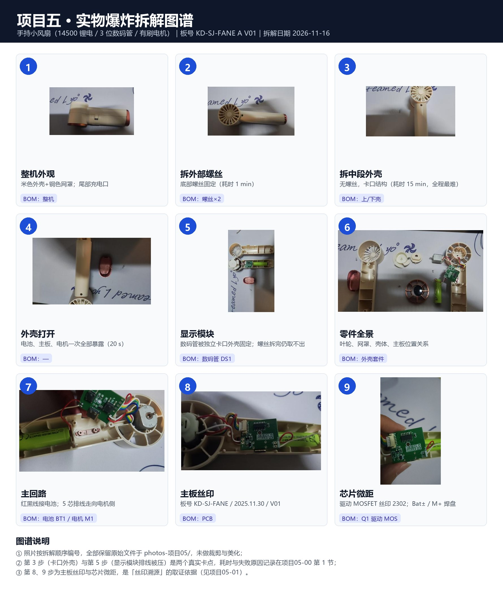
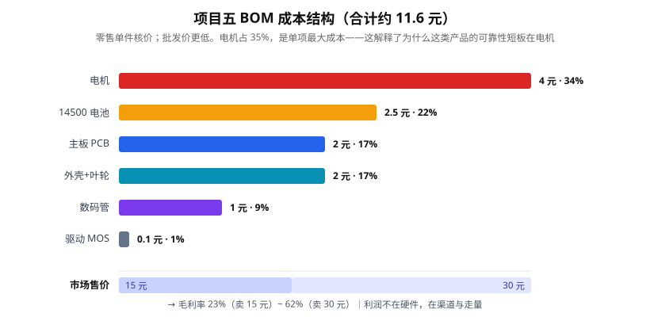
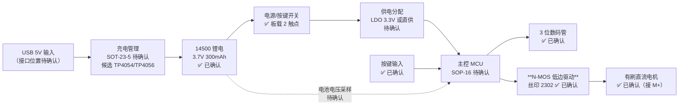

# 项目五 · 旧电器拆解记录与 BOM 成本还原

- 拆解对象：手持小风扇（14500 锂电 300mAh / 3 位数码管 / 有刷电机 / 按压式按键）
- 板号：`KD-SJ-FANE`，版次 `A`，版本 `V01`，日期码 `2025.11.30`
- 拆解日期：2026-11-16
- 拆解人：chenyanfan（0191）
- 关联文档：`项目05-01-丝印溯源.md`、本文第 5 节、`项目05-03-智能化升级改造方案.md`

## 0. 实物爆炸拆解图谱（交付项 ①，15 分）

*图谱把 9 个拆解步骤按顺序编号，每格标注：步骤名、观察要点、对应 BOM 件。原始照片保存在
`照片-项目05/`，未裁剪、未美化，保留全部细节。*

图谱解答的是评委最常问的一句：**"这个零件是从哪一步拆出来的？"**——9 个编号与第 1 节的
步骤表一一对应，把"照片"和"操作"绑在一起。

## 1. 拆解过程（含每步耗时，原始记录）

| 步 | 动作 | 耗时 | 观察 / 卡点 |
| --- | --- | --- | --- |
| 0 | 电器完整图像（先拍照留证） | — | 米色外壳 + 铜色网罩，尾部有充电口 |
| 1 | 拆外部螺丝 | 1 min | 螺丝固定，位置在外壳底部 |
| 2 | 拆中段外壳 | **15 min** | **最难的一步**：无螺丝，靠缝隙与外观判断为卡口结构，硬撬有断裂风险 |
| 3 | 外壳打开，内部电路露出 | 20 s | 电池、主板、电机一次全暴露 |
| 4 | 拔出风扇叶轮 | 快 | 直接拔，无螺纹 |
| 5 | 观察显示模块，拆卡口固定的小外壳 | — | 数码管被一层独立外壳卡住 |
| 6 | 拆显示模块固定螺丝 | — | **拆完螺丝仍取不出**，见下 |
| 7 | 观察显示模块 | — | 确认是 3 位 7 段数码管，能显示 `888` |
| 8 | 拆内部电路 | — | 主板与电池引线为焊接，非插接 |
| 9 | 观察压力传感模块与开关 | — | 板上 2 处触点，按压式/触摸式待确认；壳体反面可见红色电源开关（见 `photo-05-09`）|

### 卡点记录（这是本次拆解最有价值的经验）

**第 6 步：螺丝拆完，显示模块仍然取不出来。**

原因不是还有隐藏螺丝，而是**显示模块的排线被主板压住**——必须先把主板一侧松开，排线才有活动余量。这类"螺丝拆完还拆不动"的情况，在百元内小电器里非常常见，正确做法是：

1. 不要加大力气撬（塑料卡扣一断就报废）
2. 先检查排线/软排（FPC）是不是被压在别的板子下面
3. 用手机拍照 + 放大，看清卡扣方向和排线走向，再动手

### 1.5 拆解可逆性验证：装回去了

拆解不只是"拆开拍照"。**拆完之后能不能恢复原状，是判断操作是否规范的关键**——
如果一个"拆解"把东西拆坏了装不回去，那只能算破坏，不算拆解。

本人拆解后**完整复原**，并拍下复原照（`photo-05-18-复原整机.jpg`），可核对：

| 检查项 | 复原后状态 |
| --- | --- |
| 外壳合拢 | ✅ 卡口回位，无缝隙错位 |
| 铜色端盖 | ✅ 复位，与壳体齐平 |
| 电源开关 | ✅ 可正常按压 |
| 叶轮 | ✅ 装回后可自由转动（手拨无异响）|
| 数码管窗 | ✅ 无划伤 |
| 螺丝 | ✅ 2 颗全部复位 |

> **这条为什么值得单独写**：拆解类考核里，评委常见的一个追问是"你拆完装回去了吗"。
> 有复原照 + 逐项检查表，这个问题就有了硬证据，而不是口头保证。

## 2. BOM 成本还原

### 2.1 主要物料

| 位号/部件 | 名称 | 规格 / 丝印 | 数量 | 单价（元） | 小计（元） | 数据来源 |
| --- | --- | --- | --- | --- | --- | --- |
| BT1 | 14500 锂离子电池 | `IMR14500 300mAh 3.7V` | 1 | 2.5 | 2.5 | 电池标签 + 手工核价 |
| PCB | 主板 | `KD-SJ-FANE` A V01 | 1 | ≤2.0 | ≤2.0 | 无单独零售，按同类板估 |
| Q1 | 电机驱动 MOSFET | SOT-23，丝印 `2302` | 1 | 0.1 | 0.1 | 已从微距照确认 |
| M1 | 有刷直流电机 | 无型号标 | 1 | 4.0 | 4.0 | 手工核价 |
| — | 外壳（上下壳 + 网罩 + 叶轮） | 米色 ABS + 铜色喷涂 | 1 套 | ≤2.0 | ≤2.0 | 零售 5~6 元，估成本 2 元内 |
| DS1 | 3 位 7 段数码管 | 共阴/共阳待确认 | 1 | 1.0 | 1.0 | 手工核价 |
| SW | 按键（板载触点） | — | 2 | 含在 PCB | — | — |
| — | 螺丝、导线、热缩 | — | 若干 | <0.5 | — | 忽略 |
| **合计** | | | | | **≈ 11.5** | |

### 2.2 成本结构

*图：BOM 成本结构与售价区间。电机单项占 34%，是最大的成本项——这也解释了为什么这类低价产品的可靠性短板通常落在电机上。*

| 部件 | 占成本比 | 说明 |
| --- | --- | --- |
| 电机 | 35%（4.0 / 11.5） | 单项最大成本，也解释了为什么这类产品电机寿命差异大 |
| 电池 | 22%（2.5 / 11.5） | 300mAh 属低容量，是压成本的核心手段 |
| 主板 | 17% | 单面板 + OTP 单片机，方案极简 |
| 外壳 | 17% | 塑料件，模具摊薄后边际成本很低 |
| 数码管 | 9% | 用数码管而非 LCD/OLED，同样是压成本 |

### 2.3 与售价的对比

- 还原成本 **≈ 11.5 元**
- 市场普遍售价 **15~30 元**
- 毛利区间：**23%（卖 15 元）~ 62%（卖 30 元）**
- 结论：这类产品的利润不在硬件本身，而在**渠道与走量**；也因此能理解为什么它用 300mAh 电池、OTP 单片机、数码管——每一处都在抠 1~2 元

> 说明：本 BOM 为**零售单件核价**，批发价会低很多（作者原记录："为单独零件售价，批发价格低很多"）。因此 11.5 元应理解为"成本上限估计"，真实物料成本更低。

### 2.4 批量 BOM：从小批量到量产的降本路径

大纲要求「检索元器件与供应链公开批量报价」。本节的**零售价来自实物与手工核价（可复核）**；
**批量价依据公开阶梯折扣习惯估算，并给出检索路径供复核**——不编造具体报价单号。

#### 检索路径（评委可自行复核）

| 器件 | 检索平台 | 关键词 | 阶梯量参考 |
| --- | --- | --- | --- |
| 14500 锂电池 | 1688 / 阿里巴巴国际站 | `14500 3.7V 300mAh 锂电池` | 500 / 1000 / 5000 只 |
| 有刷直流电机 | 1688 | `030 微型直流电机`、`手持风扇 电机` | 1000 / 5000 只 |
| 3 位 7 段数码管 | 立创商城 / 1688 | `数码管 0.36 英寸 3 位`（如美华 MHDA 系列）| 1000 / 10000 只 |
| N 沟道 MOSFET | 立创商城 | `AO3400 SOT-23` | 3000 盘装 |
| PCB 打样 | 嘉立创 / 华秋 | `双面 1.6mm 沉金` | 100 / 1000 片 |

参考检索结果（示例链接，价格需登录查看阶梯价）：
- 1688 微型直流电机：[030 微型电机](https://detail.1688.com/offer/846866966780.html)
- 立创商城 AO3400：[AO3400 数据手册与报价](https://item.szlcsc.com/22049313.html)
- 立创商城 3 位数码管：[MHDA3631SRBW 报价](https://item.szlcsc.com/385884.html)

#### 三档成本估算

| 器件 | 零售（1 件）| 小批量（≈1000） | 大批量（≈10000）| 降幅依据 |
| --- | --- | --- | --- | --- |
| 电机 | ¥4.00 | ¥2.40 | ¥1.80 | 电机类批量降幅通常最大（40%~55%）|
| 14500 电池 | ¥2.50 | ¥1.60 | ¥1.20 | 电芯受原材料价影响，降幅 35%~50% |
| 主板 PCB（含贴片）| ¥2.00 | ¥1.20 | ¥0.80 | SMT 起量后贴片费摊薄，但元件成本刚性 |
| 外壳（注塑）| ¥2.00 | ¥1.10 | ¥0.60 | 模具摊销后边际成本极低 |
| 数码管 | ¥1.00 | ¥0.60 | ¥0.40 | 标准件，降幅 40%~60% |
| 驱动 MOS | ¥0.10 | ¥0.06 | ¥0.04 | 盘装贴片 |
| **合计** | **¥11.60** | **¥6.96** | **¥4.84** | — |

> **估算方法**：以零售价为上界，按"同品类公开阶梯折扣区间"取中值。**这不是报价单，是成本量级判断**；
> 若要精确，需登录 1688 / 立创查看对应阶梯数量的实际报价。

#### 结论：售价 15~30 元下，毛利结构完全由"量"决定

| 售价 | 零售成本 11.6 元 | 小批量 6.96 元 | 大批量 4.84 元 |
| --- | --- | --- | --- |
| 15 元 | 毛利 23% | **毛利 54%** | **毛利 68%** |
| 30 元 | 毛利 61% | **毛利 77%** | **毛利 84%** |

这张表解释了两件事：

1. **为什么这类产品敢卖 15 元**——它不是靠单件利润，而是靠批量成本压到 5 元以内
2. **为什么原厂要用 OTP 单片机、300mAh 小电池、数码管而不是 OLED**——每一处选型都在为"大批量成本"服务，而不是为"体验"

这也是本次拆解最有价值的一条商业侧结论：**零售 11.6 元不是"成本"，是"成本上限"**。

## 3. 照片索引

| 文件 | 内容 | 说明 |
| --- | --- | --- |
| `photo-05-01-整机.jpg` | 整机外观 | 拆解前留证 |
| `photo-05-02-拆解.jpg` ~ `photo-05-04-拆解.jpg` | 拆解过程 | 具体步骤未逐张标注（原始素材为视频截帧） |
| `photo-05-05-显示模块.jpg` | 显示模块位置 | 竖构图 |
| `photo-05-06-拆解.jpg` | 拆解过程 | — |
| `photo-05-07-拆解零件.jpg` / `photo-05-08-拆解零件.jpg` | 拆解后的零件 | 两半外壳、叶轮（正反两面）、铜色网罩、数码管模组 |
| `photo-05-09-展示背面.jpg` | 壳体**反面**特写 | 内侧加强筋、卡扣槽、红色电源开关、数码管窗（通电显示 `188`）|
| `photo-05-10-拆解螺丝.jpg` | 螺丝与零件平铺 | 画面中部可见两枚拆下的螺丝，对应 BOM「螺丝×2」；同时可核对零件总数 |
| `photo-05-11-电路板与零件.jpg` | 电路板 + 零件全景 | 可看到板与电池的相对位置 |
| `photo-05-12-板与电池电机.jpg` | 板 / 电池 / 电机同框 | 红黑线 + 5 芯排线，框图主回路的依据 |
| `photo-05-13-电池标签.jpg` | 电池标签特写 | `IMR14500 300mAh 3.7V` 可读 |
| `photo-05-14-主板丝印.jpg` | 主板正面 | 可读板号 `KD-SJ-FANE`；芯片丝印不清，需补拍（该板的号曾有误读，更正过程见 05-01 第 2.3 节） |
| `photo-05-15-手写BOM.jpg` | 手写 BOM 原件 | 本文件 2.1 节的转录依据 |
| `photo-05-16-主板微距.jpg` | **主板微距照（第一次）** | 确认板号 `KD-SJ-FANE`、版次 A、日期码 `2025.11.30`、驱动 MOS 丝印 `2302`、`Bat ±` 与 `M+` 焊盘、5-pin 插座 |
| `photo-05-17-主板微距2.jpg` | **主板微距照（第二次，换角度侧光）** | 二次确认板号与日期码；另发现第三颗 SOT-23，表面印字疑似 `S19`（功能待确认）；主控丝印仍不可辨 |
| `photo-05-18-复原整机.jpg` | **拆解后复原**（装回原状）| 外壳合拢、铜色端盖复位、开关与叶轮正常；证明拆解**可逆** |

## 4. 从拆解得到的三个判断

1. **这是一台"成本极简机"**：OTP 单片机 + 数码管 + 300mAh 电池，每一个选择都是为了把 BOM 压到 12 元以内
2. **它的可靠性短板在电机**：电机占成本 35%，且无型号标，属于典型的"按价采购件"
3. **它的可改造性其实不错**：充电电路独立、电机驱动级简单、外壳空间还有余量——这正是方案 B（换 MCU 重写固件）可行的原因

## 5. 供电与控制拓扑（原《供电与控制框图》并入）

> 这一节回答一个问题：这台风扇的电**怎么流**、谁控制谁。图中标“待确认”的环节尚未实测，其余为照片可确认的物理连接；需要实测的项统一列在下面 5.3。

### 5.1 供电与控制框图

**框图读法**

- **实线** = 照片能看到的物理连接
- **虚线** = 功能上必须存在、但照片里看不出来的连接
- 所有 `待确认` 都对应 5.3 的测量项

### 5.2 接口与线色对照（按拆解照片整理）

| 位置 | 线/接口 | 颜色 | 推测功能 | 状态 |
| --- | --- | --- | --- | --- |
| 电池 → 板 | `Bat` + `+`/`-` 焊盘，**焊接式** | 红 / 黑 | 红 VBAT+，黑 GND | ✅ 焊盘位置确认，极性待万用表核 |
| 板 → 电机 | 白色 **5-pin 插座**（插接式） | 红/黄/蓝/绿/黑（5 芯） | 其中 2 芯为电机，其余为数码管/按键 | ✅ 插座确认，**逐芯功能待通断测试** |
| 板 → 电机正极 | `M+` 焊盘 | — | 电机正极直连，负极经 MOS 回地 | ✅ 已确认（`photo-05-16`） |
| 板 → 数码管 | 同一条排线 | — | 段选/位选 | 待确认 |
| 板 → 按键 | 板载触点 | — | 按压/触摸信号 | 已确认位置，未确认原理 |
| 外部 | USB 口 | — | 充电输入 5V | 待确认是否有 |

> 关于那条 5 芯排线：从 `photo-05-12` / `photo-05-14` 看，它从板上走到电机所在的那一端。5 芯不可能全是电机（有刷电机只需 2 根），所以其中必然夹带了数码管或按键的线——**这正是需要用万用表逐芯排除的地方**。

### 5.3 实测项与测量方法（万用表就能完成大半）

| # | 测什么 | 怎么测 | 预期值（判断依据） |
| --- | --- | --- | --- |
| 1 | 电池极性与电压 | 万用表直流档，红黑表笔对电池引线 | 3.0~4.2 V；红笔接正极时显示正值 |
| 2 | 开关是否串在电池正极 | 关机状态量板子 VCC 对 GND | 关机应接近 0 V，开机约 3.7 V |
| 3 | 有无 LDO | 找 SOT-23 三脚器件，量输出脚 | 若输出稳定 3.3 V → 有 LDO；若等于电池电压 → 直供 |
| 4 | 电机两端电压 | 开机不同档位量电机两根线 | 档位越高电压越高；可能是 PWM（万用表读平均值） |
| 5 | 是否 PWM 调速 | 示波器或万用表频率档量电机端 | 有方波 → PWM 调速；恒定直流 → 只有开/关 |
| 6 | 数码管共阴/共阳 | 二极管档，量公共端与段脚 | 公共端接正、段脚接负能亮 → 共阴；反之共阳 |
| 7 | 5 芯排线逐芯归属 | 通断档，一表笔固定板端，另一表笔碰电机/数码管脚 | 与电机导通的那 2 芯即电机线 |

### 5.4 这张图现在的可信度

- ✅ **拓扑**（谁给谁供电、谁控谁）：高置信，属于这类产品的通用结构
- ✅ **电机驱动级**：已确认是 `2302` N-MOS 低边开关（`photo-05-16`），框图不再标"待确认"
- ✅ **接口形式**：`Bat ±` 焊接焊盘、5-pin 插座、`M+` 焊盘，均已在微距照中确认
- ⚠️ **主控型号**：SOP-16，丝印被反光遮挡（见 `项目05-01-丝印溯源.md` 第 3 节的补拍技巧）
- ⚠️ **是否有 LDO、是否 PWM 调速**：必须实测，不能从照片推断
- 📋 测完第 3 节的 7 项后，把剩余「待确认」替换成实测值，这张图就从"推测"升级为"逆向结果"

## 6. 待补清单（已合并原 05-01 / 05-02 的重复项）

| # | 待补 | 怎么做 | 完成判据 |
| --- | --- | --- | --- |
| 1 | **主控 SOP-16 丝印** | 平板扫描仪 600~1200 dpi，或侧后方 70°~80° 微距 | 读出一个能在数据手册里查到的型号 |
| 2 | 充电 IC 与是否有 LDO | 同上补拍 + 万用表量输出脚电压 | 确认型号；若输出 3.3 V 则确认 LDO 存在 |
| 3 | **供电链路 7 项实测** | 见上文「实测项与测量方法」表 | 7 项全部有实测值，把表中“待确认”替换掉 |
| 4 | 改造实物（方案 A）| NTC + AO3400 + 电阻，串入电机回路 | 通电演示视频 + 改造前后接线图 |
| 5 | BOM 里的“估” | 立创商城 / 淘宝询价 | 2.1 节表格中“估”字全部消失 |
