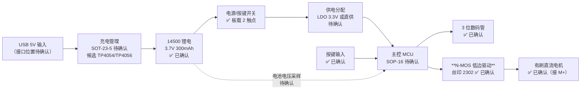

# 项目五 · 供电与控制框图

- 对象：手持小风扇（14500 锂电，3 位数码管，有刷电机）
- 板号：`KD-S1-FAN3-A V01`
- 说明：**框图中标「待确认」的环节尚未实测**，其余为照片可确认的物理连接。下方给了每个待确认点的测量方法，测完直接改这张图。

## 1. 供电与控制框图（GitHub 上会自动渲染）

### 框图读法

- **实线** = 照片能看到的物理连接
- **虚线** = 功能上必须存在、但照片里看不出来的连接
- 所有 `待确认` 都对应第 3 节的测量项

## 2. 接口与线色对照（按拆解照片整理）

| 位置 | 线/接口 | 颜色 | 推测功能 | 状态 |
| --- | --- | --- | --- | --- |
| 电池 → 板 | `Bat` + `+`/`-` 焊盘，**焊接式** | 红 / 黑 | 红 VBAT+，黑 GND | ✅ 焊盘位置确认，极性待万用表核 |
| 板 → 电机 | 白色 **5-pin 插座**（插接式） | 红/黄/蓝/绿/黑（5 芯） | 其中 2 芯为电机，其余为数码管/按键 | ✅ 插座确认，**逐芯功能待通断测试** |
| 板 → 电机正极 | `M+` 焊盘 | — | 电机正极直连，负极经 MOS 回地 | ✅ 已确认（`photo-05-16`） |
| 板 → 数码管 | 同一条排线 | — | 段选/位选 | 待确认 |
| 板 → 按键 | 板载触点 | — | 按压/触摸信号 | 已确认位置，未确认原理 |
| 外部 | USB 口 | — | 充电输入 5V | 待确认是否有 |

> 关于那条 5 芯排线：从 `photo-05-12` / `photo-05-14` 看，它从板上走到电机所在的那一端。5 芯不可能全是电机（有刷电机只需 2 根），所以其中必然夹带了数码管或按键的线——**这正是需要用万用表逐芯排除的地方**。

## 3. 待测点与测量方法（用万用表就能完成大半）

| # | 测什么 | 怎么测 | 预期值（判断依据） |
| --- | --- | --- | --- |
| 1 | 电池极性与电压 | 万用表直流档，红黑表笔对电池引线 | 3.0~4.2 V；红笔接正极时显示正值 |
| 2 | 开关是否串在电池正极 | 关机状态量板子 VCC 对 GND | 关机应接近 0 V，开机约 3.7 V |
| 3 | 有无 LDO | 找 SOT-23 三脚器件，量输出脚 | 若输出稳定 3.3 V → 有 LDO；若等于电池电压 → 直供 |
| 4 | 电机两端电压 | 开机不同档位量电机两根线 | 档位越高电压越高；可能是 PWM（万用表读平均值） |
| 5 | 是否 PWM 调速 | 示波器或万用表频率档量电机端 | 有方波 → PWM 调速；恒定直流 → 只有开/关 |
| 6 | 数码管共阴/共阳 | 二极管档，量公共端与段脚 | 公共端接正、段脚接负能亮 → 共阴；反之共阳 |
| 7 | 5 芯排线逐芯归属 | 通断档，一表笔固定板端，另一表笔碰电机/数码管脚 | 与电机导通的那 2 芯即电机线 |

## 4. 与拆解照片的对应

| 图 | 看到的东西 | 对应框图中的位置 |
| --- | --- | --- |
| `photo-05-12` | 板子 + 电池 + 电机同框，红黑线与 5 芯排线 | 电池→板→电机 主回路 |
| `photo-05-13` | 电池标签特写 `IMR14500 300mAh 3.7V` | BAT 节点 |
| `photo-05-14` | 板子正面、板号、SOP-16 主控 | MCU / 充电 / 驱动 |
| `photo-05-08` ~ `photo-05-11` | 拆开后的半壳、叶轮、网罩、数码管窗 | SEG / MOT 的机械位置 |

## 5. 这张图现在的可信度

- ✅ **拓扑**（谁给谁供电、谁控谁）：高置信，属于这类产品的通用结构
- ✅ **电机驱动级**：已确认是 `2302` N-MOS 低边开关（`photo-05-16`），框图不再标"待确认"
- ✅ **接口形式**：`Bat ±` 焊接焊盘、5-pin 插座、`M+` 焊盘，均已在微距照中确认
- ⚠️ **主控型号**：SOP-16，丝印被反光遮挡（见 `项目05-01-丝印溯源.md` 第 3 节的补拍技巧）
- ⚠️ **是否有 LDO、是否 PWM 调速**：必须实测，不能从照片推断
- 📋 测完第 3 节的 7 项后，把剩余「待确认」替换成实测值，这张图就从"推测"升级为"逆向结果"
