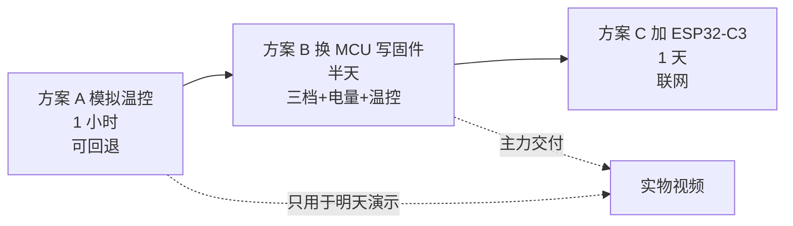

# 项目五 · 旧电器智能化升级改造方案

- 对象：14500 锂电手持小风扇（板号 `KD-S1-FAN3-A V01`）
- 现状：只有"开/关 + 固定档位"，无温度感知、无定时、无电量精度、无联网
- 改造目标：在**不破坏原机、可回退**的前提下，把它升级成"能自己判断该吹多大风"的设备，并做出可演示、可测量的实物
- 方案设计：chenyanfan（0191）｜2026-11-24

## 0. 先定验收标准（没有标准的改造就是瞎改）

| 指标 | 目标值 | 怎么测 |
| --- | --- | --- |
| 自动调速 | 温度升高 5 ℃ 时占空比至少提升 30% | 热风枪/吹风机加热 NTC，示波器量 PWM 占空比 |
| 三档手动 | 三档占空比可区分（如 30/60/90%） | 示波器或万用表频率档 |
| 电量显示 | 4.2 V→100%，3.3 V→0%，误差 <5% | 可调电源模拟电池电压，看数码管显示 |
| 待机电流 | < 50 µA | 万用表 µA 档串在电池回路 |
| 温升 | 连续 30 min 电机温升 < 15 K | 热电偶/红外测温，测电机外壳 |
| 可回退 | 剪断飞线即可恢复原机功能 | 保留原板与原始接线照片 |

## 方案 A（最快，1 小时内做完，不改固件）

**思路**：不动主控，只在**电机回路里插入一级 MOS 调速**，用 NTC 分压 + 比较器生成 PWM 占空比的替代方案——实际更简单的做法是：用 NTC 直接控制 MOS 的栅极电压（线性区），做成"越热越快"的模拟调速。

- 器件：NTC 10k（1 元）、MOS AO3400（0.3 元）、两个电阻、一个电位器（微调）
- 接线：NTC 与电阻分压 → MOS 栅极；MOS 漏源串进电机负极（低边）
- 优点：不用写代码、不用烧录器、剪线可回退
- 缺点：模拟线性区发热、调速不精确、没法做电量显示
- **适用场景**：明天就要演示、又想有个"能自己动"的东西

## 方案 B（推荐，半天，重写固件）

**思路**：保留原板的充电电路与电机驱动级，**只把主控换掉**，自己写固件。

- 替换主控：`CH32V003F4P6`（SOP-16，约 1 元，RISC-V，有 ADC/PWM/定时器）或 `STC8G1K08`（SOP-16，约 1.5 元，8051，中文资料多）
  - 选 CH32V003 的理由：SOP-16 与原来引脚数一致、有原生 PWM + ADC、开源工具链（WCH-LinkE 约 20 元）
  - 选 STC8G1K08 的理由：串口就能烧录，不需要额外调试器，零基础更省事
  - **建议：先 STC8G1K08**（省一个调试器的钱和折腾）
- 固件功能清单（按优先级，前 3 项必须先跑通）：
  1. 三档 PWM 调速（按键切换）
  2. 电池电压采样 + 3 位数码管显示电量百分比
  3. NTC 温度采样 + 自动档（超阈值自动升档）
  4. 定时关机（30/60/120 分钟）
  5. 长按 3 秒开关机，防误触
- 开发顺序：**先让数码管点亮 → 再让电机转 → 再接按键 → 最后加 NTC 与定时**（这个顺序不能反，否则出错时无法定位是哪部分的问题）
- 成本：MCU 1.5 + 烧录 0（串口）+ NTC 1 + 杂项 2 ≈ **5 元以内**
- 风险与回退：把原板主控用热风枪吹下之前，**先拍照、先量好每个脚的电压**；飞线改造，随时可焊回

## 方案 C（进阶，1 天，能联网）

**思路**：主控换成 `ESP32-C3`（模块约 6 元）+ 原驱动级，做 WiFi 控制。

- 能做的演示：手机网页看实时温度/电量、远程开关、定时任务
- 代价：3.3 V 供电要重新算（ESP32-C3 峰值电流 350 mA，原板 LDO 大概率撑不住，要外加 AMS1117 或 MP1584）、代码量翻倍
- **建议**：等 B 跑通再上 C。B 的固件结构（状态机 + 采样 + 输出）可以直接搬到 C

## 推荐路线

**一句话**：A 保底（保证有东西可演示），B 是主力（体现真实能力），C 是加分（时间够才做）。

## 改造步骤（按方案 B 展开）

| 步骤 | 动作 | 时间 | 验收 |
| --- | --- | --- | --- |
| 1 | 拍原板照片、量各脚电压并记录 | 20 min | 有一张标注了电压的板子照片 |
| 2 | 吹下原 SOP-16 主控，焊上排针/转接座 | 20 min | 能用杜邦线接出新 MCU |
| 3 | 点亮数码管（先不管电机） | 40 min | 能显示 `888` |
| 4 | 驱动电机（三极管/MOS 低边，加续流二极管） | 30 min | 三档转速肉眼可分 |
| 5 | 按键中断/消抖 | 20 min | 短按切档、长按关机 |
| 6 | ADC 采电池电压 + 换算百分比 | 30 min | 显示值与万用表差 <0.1 V |
| 7 | NTC 温控自动档 | 30 min | 吹风机加热后自动升档 |
| 8 | 定时关机 | 20 min | 到点自动停 |
| 9 | 录视频 + 写结论 | 30 min | 1 分钟演示，含示波器/万用表读数 |

合计约 **4 小时**，可拆成两个半天。

## 风险清单

| 风险 | 概率 | 应对 |
| --- | --- | --- |
| 吹主控时把焊盘吹掉 | 中 | 先练一块废板；温度 350 ℃、风量小、绕圈吹 |
| 数码管是共阳/共阴判断错 | 中 | 用二极管档先测（见框图文档第 3 节第 6 项） |
| 电机启动电流拉低电压导致 MCU 复位 | 中 | 电机端并 100 µF 电解 + 0.1 µF 瓷片；MCU 供电另加 10 µF |
| 原板 LDO 带不动新 MCU | 低 | 外挂 AMS1117-3.3 |
| 时间不够 | 高 | 退回方案 A，只交"模拟温控 + 演示视频 + 本方案文档" |

## 交付物

1. 改造后的实物 + 1 分钟演示视频（放网盘，仓库只放链接）
2. 改造接线图（手绘拍照即可，存 `photo-05-08` 之类）
3. 固件源码（放 `02-20Days-Challenge/`，带注释）
4. 本文档的实测数据回填（把上表"目标值"旁边补上"实测值"）
