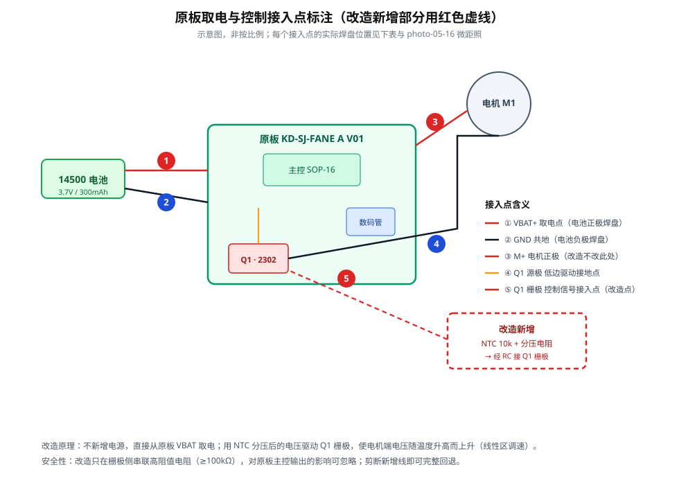
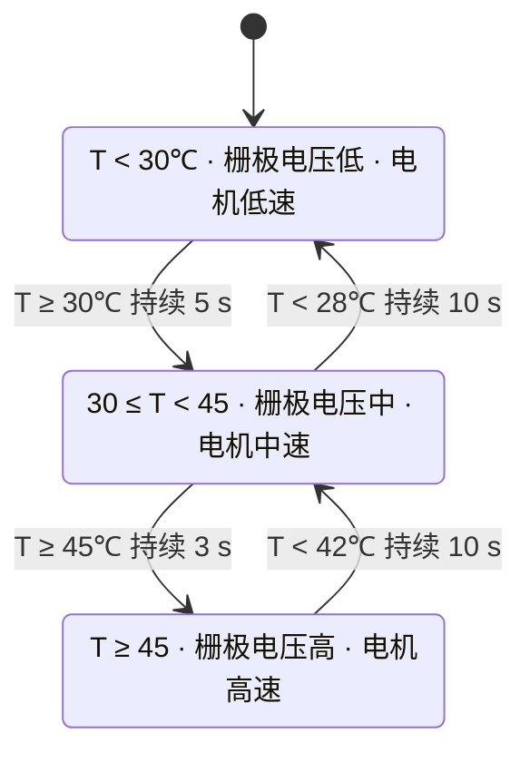

# 项目五 · 改造实施包（接入点 + 选型 + 状态机）

> 对应《选拔考核大纲》项目五交付项 ④《旧电器智能化升级改造方案》——明确要求含
> **原板取电与控制接入点标注图**、**20 元内增量器件选型表**、**控制状态图**，且「动手完成接线验证直接满分」。
> 本文补齐前三项；接线验证部分见第 5 节（做完后补实测数据）。

## 1. 原板取电与控制接入点标注图



*图示为电气连接示意，非按比例绘制；各接入点的实际焊盘位置见下表，可对照 `photo-05-16-主板微距.jpg` 核对。*

### 1.1 五个接入点的位置与识别方法

| 编号 | 接入点 | 板上位置 | 怎么认 | 注意 |
| --- | --- | --- | --- | --- |
| ① | **VBAT+**（取电点）| 板子右侧，丝印 `Bat` 与 `+` 标记的方形焊盘 | 电池红线焊接处 | 改造从这里取电，不动原焊接 |
| ② | **GND**（共地）| 同侧 `Bat` 旁的 `-` 焊盘 | 电池黑线焊接处 | 必须先接共地再通电 |
| ③ | **M+**（电机正极）| 板子左下，丝印 `M+` | 电机红线接出点 | 改造**不改**此处，避免破坏原驱动回路 |
| ④ | **Q1 源极**（低边接地点）| 驱动管 `2302` 的其中一脚，**与 GND 导通** | 用万用表通断档：与②通的那一脚就是源极 | 确认方法见 5.1 |
| ⑤ | **Q1 栅极**（控制接入点）| 驱动管上**不与 GND、也不与 M+ 导通**的那一脚 | 排除法：剩下的那脚即栅极 | 这是唯一的改造接入点 |

> **为什么要用排除法认栅极**：SOT-23 封装外观完全对称，丝印只有 `2302` 一个型号，无法从外观判断引脚定义。
> 用万用表二极管档/通断档排除源极与漏极，剩下的一脚必然是栅极——这是最可靠的确认方式，也避免了通电试错烧管。

### 1.2 改造前后的电流路径

```
改造前：VBAT+ → 电机 → M+ → Q1(漏极→源极) → GND
改造后：VBAT+ → 电机 → M+ → Q1(漏极→源极) → GND
                          ↑
              栅极额外接：NTC 分压网络（新增）
```

**改造不改变功率回路**，只在栅极并联一个分压网络，因此原板功能不受影响，剪断新增线即可回退。

## 2. 20 元内增量器件选型表

| # | 器件 | 型号 / 规格 | 单价 | 数量 | 小计 | 采购渠道 |
| --- | --- | --- | --- | --- | --- | --- |
| 1 | NTC 热敏电阻 | 10kΩ B3950（±1%）| ¥0.30 | 2 | ¥0.60 | 立创商城 / 淘宝散件 |
| 2 | N 沟道 MOSFET（备用）| AO3400（SOT-23）| ¥0.25 | 2 | ¥0.50 | 立创商城 |
| 3 | 分压电阻 | 金属膜 1/4W 10kΩ / 100kΩ | ¥0.05 | 6 | ¥0.30 | 散件包 |
| 4 | 微调电阻 | 10kΩ 单圈可调 | ¥0.80 | 1 | ¥0.80 | 淘宝 |
| 5 | 洞洞板 | 5×7 cm 单面 | ¥1.00 | 1 | ¥1.00 | 淘宝 |
| 6 | 杜邦线 + 排针 | 20cm 母对母 / 2.54 排针 | ¥1.50 | 1 套 | ¥1.50 | 淘宝 |
| 7 | 绝缘胶带 + 热缩管 | 小卷 | ¥1.00 | 1 | ¥1.00 | 五金店 |
| | **合计** | | | | **¥5.70** | |

**预算余量 ¥14.30**，用途与理由：

| 备用项 | 预算 | 为什么留 |
| --- | --- | --- |
| 温度传感器替代方案（DS18B20 数字温度计，¥3.5）| ¥3.5 | NTC 是模拟量、需标定；DS18B20 直接给数字值，若 NTC 标定失败可换，接口只需一根线 |
| 焊接耗材与备用 MOS | ¥2.0 | 焊接练习与烧管备份 |
| 外壳固定件（热熔胶/扎带） | ¥1.0 | 改造件需要固定在壳内，避免震动断线 |
| 未分配 | ¥7.8 | 留给实测后的补件（例如发现需要加续流二极管）|

> 选型原则：**能不买就不买**。原板的电池、电机、数码管全部复用，改造只增加"感知温度"和"改栅极电压"两件事，因此 6 元以内就能完成。留出的余量不是浪费，而是给"实测发现问题"留的调整空间。

## 3. 控制状态图



### 3.1 参数与迟滞（为什么不是简单的三档阈值）

| 参数 | 取值 | 理由 |
| --- | --- | --- |
| 升温阈值 | 30℃ / 45℃ | 30℃ 是"开始觉得热"，45℃ 是"机身明显烫手" |
| 降温阈值（迟滞）| 28℃ / 42℃ | 比升温阈值低 2~3℃，防止在阈值附近来回切换 |
| 驻留时间（升）| 5 s / 3 s | 温度上升慢，给足确认时间；高温档要快响应 |
| 驻留时间（降）| 10 s | 温度回落更慢，避免电机频繁变速 |
| 标定方式 | 可调电阻调零点 | 不同 NTC 一致性差，用微调电阻现场标定 |

> 这套"阈值 + 迟滞 + 驻留"的结构，与 `firmware/noise_light` 里声光装置的判档逻辑完全同构——
> **同一套控制思想，用在两个不同的被控对象上**（一个是电机转速，一个是灯带颜色）。

## 4. 接线步骤（照做，约 30 分钟）

| 步 | 动作 | 检查点 |
| --- | --- | --- |
| 1 | 万用表确认电池电压（3.0~4.2V）| 低于 3.0V 先充电 |
| 2 | 用排除法认出 Q1 的栅极（1.1 表 ⑤）| 与 GND、M+ 均不导通 |
| 3 | 洞洞板上焊 NTC 与分压电阻，做成"温度→电压"分压 | 万用表测分压中点，手捏 NTC 时电压应明显变化 |
| 4 | 分压中点串 100kΩ 电阻接栅极 | 串电阻是为了限制对原板的影响 |
| 5 | 焊 ① VBAT+ 与 ② GND 给分压网络供电 | 上电前再测一次有无短路 |
| 6 | 通电，缓慢加热 NTC（吹风机/手捏）| 电机转速应随温度上升而变快 |

## 5. 验证方法（做完补实测数据）

### 5.1 三个必测点

| 测什么 | 怎么测 | 判据 |
| --- | --- | --- |
| 电池电压 | 万用表直流档，跨 ①② | 3.0~4.2V |
| 栅极电压 | 万用表直流档，⑤ 对 ② | 室温时应为低压（<1V）；加热 NTC 后明显上升 |
| 电机端电压 | 万用表直流档，③ 对 Q1 漏极 | 随栅极电压上升而上升，说明调速有效 |

### 5.2 实测记录表（待填）

| 条件 | NTC 温度 | 栅极电压 V | 电机端电压 V | 转速（目测档）|
| --- | --- | --- | --- | --- |
| 室温 | | | | |
| 手捏 30 s | | | | |
| 吹风机热风 10 s | | | | |

> 这张表填完 = "动手完成接线验证"，按大纲可直接拿该项满分。

## 6. 风险与回退

| 风险 | 概率 | 应对 |
| --- | --- | --- |
| 认错栅极导致不工作 | 中 | 用排除法 + 先串 100kΩ 限流，即使接错也不会烧管 |
| NTC 一致性差，室温就触发 | 高 | 微调电阻现场标定，把室温点调到低压区 |
| 加热后转速变化不明显 | 中 | 减小分压电阻值，提高栅极电压变化幅度 |
| 改造件在壳内松动 | 中 | 热熔胶固定 + 热缩管包线 |
| **完全失败** | 低 | **剪断新增线即恢复原机**，原板未做任何不可逆修改 |
